<div align="center">

# 🧠 Top 250 Data Structures Interview Questions & Answers (2026)

### Beginner → Intermediate → Advanced | Java Examples | Mermaid Diagrams | Easy Indian English

**A complete data structures interview handbook by [Code with Jamshed](https://github.com/Jamshed7664)**

[](#-topics--question-count)
[](#-how-to-use-this-guide)
[](examples/DataStructurePlayground.java)
[](#-study-plan)
[](LICENSE)

[Start Learning](#-topics--question-count) · [Quick Revision](#-complexity-cheat-sheet) · [Java Practice](examples/DataStructurePlayground.java) · [Study Plan](#-study-plan) · [Contribute](CONTRIBUTING.md)

</div>

---

## ✨ What makes this guide useful?

- **250 unique interview questions** organised into **18 sections**, from data structure basics to B+ trees and persistent segment trees.
- **Every answer** contains a plain-English explanation, a concrete example, complexity details and an interview caution/tip.
- **18+ GitHub-rendered Mermaid diagrams** to explain relationships and layouts visually—no external image hosting needed.
- **Java-focused** teaching snippets throughout, plus a **runnable, tested Java playground** with important implementations.
- **Interview-ready learning path** covering conceptual questions, algorithmic patterns and real-world design choices.
- **Fast navigation:** jump to a section, browse its question index or expand an answer.

> **Java version:** Examples target Java 17+. Snippets inside answers focus on the technique and may need the shared `Node` / `TreeNode` types, `java.util.*` imports or a surrounding class. The companion `examples/DataStructurePlayground.java` is a standalone runnable program.
>
> **Diagram note:** Mermaid diagrams render on GitHub. If reading the raw Markdown elsewhere, a plain-text example inside every question still explains the concept.

## 📚 Topics & question count

| # | Topic | Level | Questions | Jump |
|:--:|---|---|:--:|---|
| 01 | Foundations & Complexity | Beginner | 15 | [Open](#topic-01) |
| 02 | Arrays & Dynamic Arrays | Beginner | 15 | [Open](#topic-02) |
| 03 | Strings & Character Structures | Beginner | 10 | [Open](#topic-03) |
| 04 | Linked Lists | Beginner → Intermediate | 20 | [Open](#topic-04) |
| 05 | Stacks & Monotonic Stacks | Beginner → Intermediate | 15 | [Open](#topic-05) |
| 06 | Queues, Deques & Scheduling | Beginner → Intermediate | 15 | [Open](#topic-06) |
| 07 | Hash Tables, Sets & Maps | Intermediate | 15 | [Open](#topic-07) |
| 08 | Recursion, Backtracking & Memory | Intermediate | 10 | [Open](#topic-08) |
| 09 | Binary Trees & Terminology | Intermediate | 15 | [Open](#topic-09) |
| 10 | Traversals, Views & Tree Problems | Intermediate | 15 | [Open](#topic-10) |
| 11 | Binary Search Trees (BST) | Intermediate | 15 | [Open](#topic-11) |
| 12 | Heaps & Priority Queues | Intermediate | 15 | [Open](#topic-12) |
| 13 | Tries & Prefix Data Structures | Intermediate | 10 | [Open](#topic-13) |
| 14 | Graphs & Representations | Intermediate → Advanced | 15 | [Open](#topic-14) |
| 15 | Graph Traversal & Algorithms | Advanced | 15 | [Open](#topic-15) |
| 16 | Disjoint Set Union (DSU) | Advanced | 10 | [Open](#topic-16) |
| 17 | Segment Trees, BIT & Range Queries | Advanced | 15 | [Open](#topic-17) |
| 18 | Balanced Trees & Advanced Structures | Advanced | 10 | [Open](#topic-18) |
| | **Total** | **Beginner → Advanced** | **250** | |

<details>
<summary><b>🧭 Open the complete 250-question navigation index</b></summary>


### 01 · Foundations & Complexity

- [Q001. What is a data structure?](#q001)
- [Q002. What is the difference between a data structure and an algorithm?](#q002)
- [Q003. What are linear and non-linear data structures?](#q003)
- [Q004. What are static and dynamic data structures?](#q004)
- [Q005. What are abstract data types (ADTs)?](#q005)
- [Q006. What is Big-O notation?](#q006)
- [Q007. What are Big-Theta and Big-Omega?](#q007)
- [Q008. What is time complexity versus space complexity?](#q008)
- [Q009. What is amortised analysis?](#q009)
- [Q010. What is a time–space trade-off?](#q010)
- [Q011. Why does cache locality matter?](#q011)
- [Q012. What is a pointer or reference in Java?](#q012)
- [Q013. How do you choose a data structure for a problem?](#q013)
- [Q014. What is recursion and what is the call stack?](#q014)
- [Q015. What is an invariant in data structures?](#q015)


### 02 · Arrays & Dynamic Arrays

- [Q016. What is an array?](#q016)
- [Q017. How are arrays different from ArrayList?](#q017)
- [Q018. Why is random access in an array O(1)?](#q018)
- [Q019. What happens when you insert in the middle of an array?](#q019)
- [Q020. How do you reverse an array in place?](#q020)
- [Q021. How do you find the largest and second-largest distinct values?](#q021)
- [Q022. What is prefix sum?](#q022)
- [Q023. What is a difference array?](#q023)
- [Q024. What is the two-pointer technique?](#q024)
- [Q025. How do you remove duplicates from a sorted array in place?](#q025)
- [Q026. What is a sliding window?](#q026)
- [Q027. What is Kadane’s algorithm?](#q027)
- [Q028. How do you rotate an array by k positions?](#q028)
- [Q029. What is a 2D array and a jagged array?](#q029)
- [Q030. When is a circular array useful?](#q030)


### 03 · Strings & Character Structures

- [Q031. Why is String immutable in Java?](#q031)
- [Q032. When should you use StringBuilder?](#q032)
- [Q033. How can you check if a string is a palindrome?](#q033)
- [Q034. How do you find character frequencies?](#q034)
- [Q035. How do you check whether two strings are anagrams?](#q035)
- [Q036. What is run-length encoding?](#q036)
- [Q037. What is the difference between substring and subsequence?](#q037)
- [Q038. What is the KMP prefix-function or LPS array?](#q038)
- [Q039. What is rolling hash in string matching?](#q039)
- [Q040. How do you find the longest substring without repeated characters?](#q040)


### 04 · Linked Lists

- [Q041. What is a singly linked list?](#q041)
- [Q042. What is a doubly linked list?](#q042)
- [Q043. What is a circular linked list?](#q043)
- [Q044. Array versus linked list: which is faster?](#q044)
- [Q045. How do you insert a node at the beginning?](#q045)
- [Q046. How do you insert at the end of a singly linked list?](#q046)
- [Q047. How do you delete a node by value?](#q047)
- [Q048. How do you reverse a singly linked list iteratively?](#q048)
- [Q049. How do you reverse a linked list recursively?](#q049)
- [Q050. How can you find the middle node?](#q050)
- [Q051. How do you detect a cycle in a linked list?](#q051)
- [Q052. How do you find the starting node of a cycle?](#q052)
- [Q053. How do you remove a cycle from a linked list?](#q053)
- [Q054. How do you merge two sorted linked lists?](#q054)
- [Q055. How do you remove the Nth node from the end?](#q055)
- [Q056. How do you check whether a linked list is a palindrome?](#q056)
- [Q057. How do you find the intersection of two linked lists?](#q057)
- [Q058. How do you clone a list with random pointers?](#q058)
- [Q059. What is an LRU cache and how is it implemented?](#q059)
- [Q060. How do you add two numbers stored in linked lists?](#q060)


### 05 · Stacks & Monotonic Stacks

- [Q061. What is a stack?](#q061)
- [Q062. How do you implement a stack using an array?](#q062)
- [Q063. How do you implement a stack using a linked list?](#q063)
- [Q064. Which Java class should you use for a stack?](#q064)
- [Q065. How do you validate balanced parentheses?](#q065)
- [Q066. How do you reverse a string with a stack?](#q066)
- [Q067. What is a monotonic stack?](#q067)
- [Q068. How do you find the next greater element?](#q068)
- [Q069. What is the stock span problem?](#q069)
- [Q070. How do you find the largest rectangle in a histogram?](#q070)
- [Q071. How do you evaluate a postfix expression?](#q071)
- [Q072. How do you convert infix to postfix?](#q072)
- [Q073. What is a Min Stack?](#q073)
- [Q074. How do you implement a queue using two stacks?](#q074)
- [Q075. What is the difference between the call stack and a manual stack?](#q075)


### 06 · Queues, Deques & Scheduling

- [Q076. What is a queue?](#q076)
- [Q077. How do you implement a queue using a circular array?](#q077)
- [Q078. What is a deque?](#q078)
- [Q079. What is the difference between Queue and PriorityQueue?](#q079)
- [Q080. What is a monotonic deque?](#q080)
- [Q081. How do you compute sliding-window maximum?](#q081)
- [Q082. How do you implement a stack using queues?](#q082)
- [Q083. What is a blocking queue?](#q083)
- [Q084. What is producer–consumer with a queue?](#q084)
- [Q085. What is a circular queue used for?](#q085)
- [Q086. How does BFS use a queue?](#q086)
- [Q087. What is round-robin scheduling?](#q087)
- [Q088. What is the difference between a deque and linked list?](#q088)
- [Q089. How would you design a recent-events buffer?](#q089)
- [Q090. How do you solve first non-repeating character in a stream?](#q090)


### 07 · Hash Tables, Sets & Maps

- [Q091. What is hashing?](#q091)
- [Q092. What is a hash collision?](#q092)
- [Q093. What is separate chaining?](#q093)
- [Q094. What is open addressing?](#q094)
- [Q095. What is load factor in a hash table?](#q095)
- [Q096. HashMap versus HashSet: what is the difference?](#q096)
- [Q097. HashMap versus TreeMap: when should you choose each?](#q097)
- [Q098. What is LinkedHashMap?](#q098)
- [Q099. How do equals() and hashCode() work together?](#q099)
- [Q100. How do you solve Two Sum using a map?](#q100)
- [Q101. How do you group anagrams?](#q101)
- [Q102. How do you find the longest consecutive sequence?](#q102)
- [Q103. What is a Bloom filter?](#q103)
- [Q104. What is consistent hashing?](#q104)
- [Q105. What is a Count-Min Sketch?](#q105)


### 08 · Recursion, Backtracking & Memory

- [Q106. What is a recursive base case?](#q106)
- [Q107. What is tail recursion?](#q107)
- [Q108. What is backtracking?](#q108)
- [Q109. How do you generate subsets?](#q109)
- [Q110. How do you generate permutations?](#q110)
- [Q111. What is memoisation?](#q111)
- [Q112. What is the difference between DFS recursion and iterative DFS?](#q112)
- [Q113. How do you estimate recursive space complexity?](#q113)
- [Q114. What is a recursion tree?](#q114)
- [Q115. What is pruning in backtracking?](#q115)


### 09 · Binary Trees & Terminology

- [Q116. What is a tree data structure?](#q116)
- [Q117. What is a binary tree?](#q117)
- [Q118. What are root, leaf, parent, child and sibling?](#q118)
- [Q119. What are depth and height of a node?](#q119)
- [Q120. What is a full binary tree?](#q120)
- [Q121. What is a complete binary tree?](#q121)
- [Q122. What is a perfect binary tree?](#q122)
- [Q123. What is a balanced binary tree?](#q123)
- [Q124. What is a skewed binary tree?](#q124)
- [Q125. How many nodes can appear on level k?](#q125)
- [Q126. How do you represent a binary tree using pointers?](#q126)
- [Q127. How do you represent a complete binary tree in an array?](#q127)
- [Q128. How do you count nodes in a binary tree?](#q128)
- [Q129. How do you find the height of a binary tree?](#q129)
- [Q130. How can you check whether two binary trees are identical?](#q130)


### 10 · Traversals, Views & Tree Problems

- [Q131. What is preorder traversal?](#q131)
- [Q132. What is inorder traversal?](#q132)
- [Q133. What is postorder traversal?](#q133)
- [Q134. How do you do level-order traversal?](#q134)
- [Q135. How do you perform inorder traversal iteratively?](#q135)
- [Q136. What is zigzag or spiral level-order traversal?](#q136)
- [Q137. How do you find the diameter of a binary tree?](#q137)
- [Q138. How do you check if a binary tree is height-balanced?](#q138)
- [Q139. How do you check whether a tree is symmetric?](#q139)
- [Q140. What is the lowest common ancestor (LCA)?](#q140)
- [Q141. What is vertical-order traversal?](#q141)
- [Q142. What are top view and bottom view?](#q142)
- [Q143. What are left and right views of a binary tree?](#q143)
- [Q144. What is boundary traversal?](#q144)
- [Q145. How do you serialise and deserialise a binary tree?](#q145)


### 11 · Binary Search Trees (BST)

- [Q146. What is a binary search tree?](#q146)
- [Q147. How do you search in a BST?](#q147)
- [Q148. How do you insert in a BST?](#q148)
- [Q149. How do you delete a node from a BST?](#q149)
- [Q150. How do you find the minimum and maximum in a BST?](#q150)
- [Q151. What is an inorder successor in a BST?](#q151)
- [Q152. What is an inorder predecessor in a BST?](#q152)
- [Q153. How do you validate a BST correctly?](#q153)
- [Q154. How do you find kth smallest in a BST?](#q154)
- [Q155. How do you find kth largest in a BST?](#q155)
- [Q156. How do you find LCA in a BST?](#q156)
- [Q157. What is floor and ceiling in a BST?](#q157)
- [Q158. How do you convert a sorted array to a balanced BST?](#q158)
- [Q159. What is an order-statistic tree?](#q159)
- [Q160. When should you prefer TreeSet over HashSet?](#q160)


### 12 · Heaps & Priority Queues

- [Q161. What is a binary heap?](#q161)
- [Q162. What is min-heap versus max-heap?](#q162)
- [Q163. How does heap insertion work?](#q163)
- [Q164. How does extract-min work?](#q164)
- [Q165. What is heapify?](#q165)
- [Q166. Why is build-heap O(n) instead of O(n log n)?](#q166)
- [Q167. How do you find the kth largest element with a heap?](#q167)
- [Q168. How do you find top K frequent elements?](#q168)
- [Q169. How do you merge K sorted lists?](#q169)
- [Q170. How do you find median from a data stream?](#q170)
- [Q171. What is heap sort?](#q171)
- [Q172. How is a heap different from a BST?](#q172)
- [Q173. What is a d-ary heap?](#q173)
- [Q174. What is a pairing heap?](#q174)
- [Q175. How do priority queues support Dijkstra’s algorithm?](#q175)


### 13 · Tries & Prefix Data Structures

- [Q176. What is a trie?](#q176)
- [Q177. How do you insert a word into a trie?](#q177)
- [Q178. How do you search for a complete word in a trie?](#q178)
- [Q179. How do you check startsWith in a trie?](#q179)
- [Q180. How do you delete a word from a trie?](#q180)
- [Q181. What is autocomplete using a trie?](#q181)
- [Q182. How do you support wildcard word search in a trie?](#q182)
- [Q183. What is a compressed trie or radix tree?](#q183)
- [Q184. What is a binary trie for integers?](#q184)
- [Q185. Trie versus HashMap for string lookup: when to use each?](#q185)


### 14 · Graphs & Representations

- [Q186. What is a graph?](#q186)
- [Q187. What is a directed versus undirected graph?](#q187)
- [Q188. What is a weighted graph?](#q188)
- [Q189. What is an adjacency list?](#q189)
- [Q190. What is an adjacency matrix?](#q190)
- [Q191. Adjacency list versus matrix: which should you use?](#q191)
- [Q192. What is vertex degree?](#q192)
- [Q193. What are path, walk and cycle?](#q193)
- [Q194. What is a connected component?](#q194)
- [Q195. What are strongly connected components (SCCs)?](#q195)
- [Q196. What is a DAG?](#q196)
- [Q197. What is a spanning tree?](#q197)
- [Q198. How do you represent a graph in Java?](#q198)
- [Q199. What is a bipartite graph?](#q199)
- [Q200. What is a graph bridge and articulation point?](#q200)


### 15 · Graph Traversal & Algorithms

- [Q201. What is graph BFS?](#q201)
- [Q202. What is graph DFS?](#q202)
- [Q203. How do you find shortest paths in an unweighted graph?](#q203)
- [Q204. How do you detect a cycle in an undirected graph?](#q204)
- [Q205. How do you detect a cycle in a directed graph?](#q205)
- [Q206. What is topological sorting?](#q206)
- [Q207. What is Kahn’s algorithm?](#q207)
- [Q208. What is Dijkstra’s algorithm?](#q208)
- [Q209. What is Bellman–Ford?](#q209)
- [Q210. What is Floyd–Warshall?](#q210)
- [Q211. What is a minimum spanning tree (MST)?](#q211)
- [Q212. What is Kruskal’s algorithm?](#q212)
- [Q213. What is Prim’s algorithm?](#q213)
- [Q214. How do you count islands in a grid?](#q214)
- [Q215. What is flood fill?](#q215)


### 16 · Disjoint Set Union (DSU)

- [Q216. What is Disjoint Set Union?](#q216)
- [Q217. What is Find in DSU?](#q217)
- [Q218. What is Union in DSU?](#q218)
- [Q219. What is path compression?](#q219)
- [Q220. What is union by rank?](#q220)
- [Q221. What is union by size?](#q221)
- [Q222. How do you count connected components with DSU?](#q222)
- [Q223. How can DSU detect an undirected graph cycle?](#q223)
- [Q224. How does DSU help Kruskal’s algorithm?](#q224)
- [Q225. What is rollback DSU?](#q225)


### 17 · Segment Trees, BIT & Range Queries

- [Q226. What is a segment tree?](#q226)
- [Q227. How do you build a segment tree?](#q227)
- [Q228. How does segment-tree range sum work?](#q228)
- [Q229. How does segment-tree point update work?](#q229)
- [Q230. What is lazy propagation?](#q230)
- [Q231. What is Range Minimum Query (RMQ)?](#q231)
- [Q232. What is a Fenwick tree (Binary Indexed Tree)?](#q232)
- [Q233. How does the lowbit operation work in BIT?](#q233)
- [Q234. Fenwick tree versus segment tree?](#q234)
- [Q235. What is a sparse table?](#q235)
- [Q236. What is Mo’s algorithm?](#q236)
- [Q237. What is a persistent segment tree?](#q237)
- [Q238. What is coordinate compression?](#q238)
- [Q239. What is an interval tree?](#q239)
- [Q240. How do you handle range add and point query efficiently?](#q240)


### 18 · Balanced Trees & Advanced Structures

- [Q241. What is an AVL tree?](#q241)
- [Q242. What is a tree rotation?](#q242)
- [Q243. What is a Red–Black tree?](#q243)
- [Q244. AVL versus Red–Black tree: what is the trade-off?](#q244)
- [Q245. What is a B-tree?](#q245)
- [Q246. What is a B+ tree?](#q246)
- [Q247. B-tree versus B+ tree?](#q247)
- [Q248. What is a skip list?](#q248)
- [Q249. What is a suffix array?](#q249)
- [Q250. How do you choose between advanced data structures in interviews?](#q250)

</details>

## 🧩 How to use this guide

**Step 1:** Read the section diagram first. **Step 2:** Attempt the question yourself before expanding it. **Step 3:** Compare your reasoning with the answer, example, complexity and tip. **Step 4:** Run the Java playground or implement the same idea on paper. **Step 5:** Revisit tricky questions after a few days.

**Levels:** 🟢 Beginner = fundamentals; 🟡 Intermediate = common interview patterns; 🔴 Advanced = implementation trade-offs and specialised structures.

---
<a id="topic-01"></a>

## 🟢 01 · Foundations & Complexity

> **Focus:** Start here: terminology, trade-offs, Big-O and how to justify a structure in interviews.

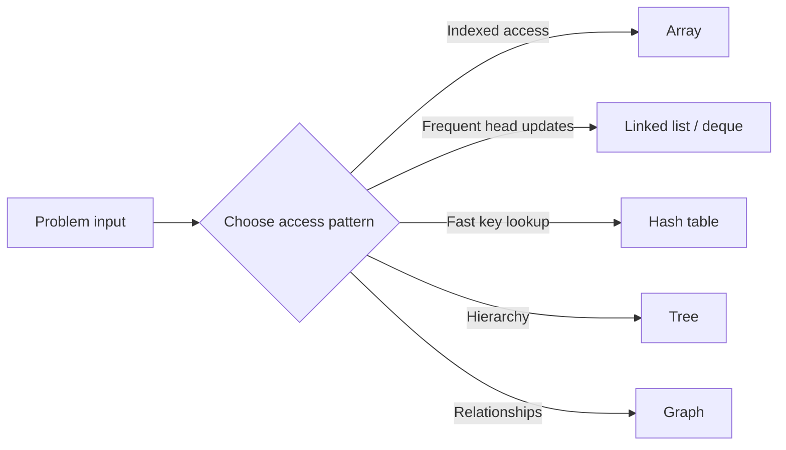


<details><summary><strong>View all 15 questions in this topic</strong></summary>

- [Q001. What is a data structure?](#q001)
- [Q002. What is the difference between a data structure and an algorithm?](#q002)
- [Q003. What are linear and non-linear data structures?](#q003)
- [Q004. What are static and dynamic data structures?](#q004)
- [Q005. What are abstract data types (ADTs)?](#q005)
- [Q006. What is Big-O notation?](#q006)
- [Q007. What are Big-Theta and Big-Omega?](#q007)
- [Q008. What is time complexity versus space complexity?](#q008)
- [Q009. What is amortised analysis?](#q009)
- [Q010. What is a time–space trade-off?](#q010)
- [Q011. Why does cache locality matter?](#q011)
- [Q012. What is a pointer or reference in Java?](#q012)
- [Q013. How do you choose a data structure for a problem?](#q013)
- [Q014. What is recursion and what is the call stack?](#q014)
- [Q015. What is an invariant in data structures?](#q015)

</details>

<a id="q001"></a>
<details>
<summary><strong>Q001. What is a data structure?</strong></summary>

**Answer — in easy English:** A data structure is a way to organise and store data so operations such as reading, searching, inserting and deleting can be performed efficiently. The right choice depends on how the application uses its data, not only on how much data it holds.

**Example:** An array fits indexed marks; a hash map fits looking up a student by roll number.

**Complexity:** Performance depends on operations and implementation.

**🎯 Interview tip:** Always ask which operations are frequent before choosing a structure.

</details>

<a id="q002"></a>
<details>
<summary><strong>Q002. What is the difference between a data structure and an algorithm?</strong></summary>

**Answer — in easy English:** A data structure defines how data is represented and accessed. An algorithm is a sequence of steps that processes that data to solve a problem. Their design affects each other: a good algorithm can become slow with an unsuitable representation.

**Example:** BFS is an algorithm; the queue and adjacency list it uses are data structures.

**Complexity:** Analyse the algorithm and underlying structures together.

**🎯 Interview tip:** Do not confuse a traversal technique with a container.

</details>

<a id="q003"></a>
<details>
<summary><strong>Q003. What are linear and non-linear data structures?</strong></summary>

**Answer — in easy English:** Linear structures arrange elements in a sequence, such as arrays, linked lists, stacks and queues. Non-linear structures connect elements hierarchically or as a network, such as trees and graphs. The distinction is about logical relationships, not storage layout.

**Example:** A playlist is linear; an organisation chart is hierarchical.

**Complexity:** Depends on the chosen structure.

**🎯 Interview tip:** A tree may still be stored in an array.

</details>

<a id="q004"></a>
<details>
<summary><strong>Q004. What are static and dynamic data structures?</strong></summary>

**Answer — in easy English:** A static structure has a fixed capacity once allocated; a dynamic structure can grow or shrink through allocation or resizing. A dynamic array changes capacity by allocating a larger backing array when required, so individual appends may occasionally be expensive.

**Example:** Java int[] has fixed length; ArrayList resizes as needed.

**Complexity:** Dynamic array append is amortised O(1).

**🎯 Interview tip:** Size is the number of elements; capacity is the allocated room.

</details>

<a id="q005"></a>
<details>
<summary><strong>Q005. What are abstract data types (ADTs)?</strong></summary>

**Answer — in easy English:** An ADT specifies allowed operations and their behaviour without prescribing the implementation. A stack ADT requires push, pop and peek; it can be implemented using an array or linked list. This separation improves API design and testing.

**Example:** Java Deque can provide stack-like push/pop semantics.

**Complexity:** Operation cost depends on implementation.

**🎯 Interview tip:** Learn what an ADT promises before memorising its code.

</details>

<a id="q006"></a>
<details>
<summary><strong>Q006. What is Big-O notation?</strong></summary>

**Answer — in easy English:** Big-O describes an asymptotic upper bound on how resource usage grows with input size. It helps compare scalability while ignoring constant factors for large inputs, but practical runtime also depends on memory locality and hardware.

**Example:** A single loop over n values is O(n); two nested full loops are O(n²).

**Complexity:** O(1), O(log n), O(n), O(n log n), O(n²) are common classes.

**🎯 Interview tip:** State what n represents and whether you discuss worst-case time.

</details>

<a id="q007"></a>
<details>
<summary><strong>Q007. What are Big-Theta and Big-Omega?</strong></summary>

**Answer — in easy English:** Big-Theta gives an asymptotically tight bound, while Big-Omega gives a lower bound. For a simple loop that always visits n items, runtime is Θ(n), and therefore also O(n) and Ω(n). These are mathematical bounds, not synonyms for best and worst case.

**Example:** Scanning all elements to calculate a sum takes Θ(n) time.

**Complexity:** Use a tight Θ bound when it is known.

**🎯 Interview tip:** Specify which input cases you are analysing.

</details>

<a id="q008"></a>
<details>
<summary><strong>Q008. What is time complexity versus space complexity?</strong></summary>

**Answer — in easy English:** Time complexity estimates the growth of computational work. Auxiliary space measures extra memory used beyond input storage; total space includes the input as well. A solution may trade memory for speed, for example by using a hash set to detect duplicates.

**Example:** A nested loop may use O(1) extra space; a set approach often uses O(n).

**Complexity:** Report time and auxiliary space separately.

**🎯 Interview tip:** Recursive call stacks consume extra space.

</details>

<a id="q009"></a>
<details>
<summary><strong>Q009. What is amortised analysis?</strong></summary>

**Answer — in easy English:** Amortised analysis spreads the cost of occasional expensive operations over a sequence of cheap ones. When a dynamic array doubles its capacity, a resize copies many items, but the total copying across many appends is linear.

**Example:** Repeated ArrayList.add at the end averages O(1) per append.

**Complexity:** Append O(1) amortised, O(n) during resize.

**🎯 Interview tip:** Amortised complexity is not the same as average over random inputs.

</details>

<a id="q010"></a>
<details>
<summary><strong>Q010. What is a time–space trade-off?</strong></summary>

**Answer — in easy English:** You can often reduce repeated computation by storing intermediate results, or save memory by doing more work. The correct balance depends on input limits, latency and available memory. Common examples include memoisation and hash lookups.

**Example:** Two Sum uses a hash map for O(n) time instead of an O(n²) pair scan.

**Complexity:** Hashing often gives O(n) time with O(n) extra space.

**🎯 Interview tip:** Mention constraints when proposing an optimisation.

</details>

<a id="q011"></a>
<details>
<summary><strong>Q011. Why does cache locality matter?</strong></summary>

**Answer — in easy English:** Modern CPUs load nearby memory into cache. Contiguous arrays often benefit from fewer cache misses compared with pointer-heavy lists, even when theoretical complexities appear similar. This is one reason arrays are fast in real applications.

**Example:** Traversing an int[] is usually cache-friendlier than visiting scattered linked-list nodes.

**Complexity:** Big-O does not model cache-miss cost directly.

**🎯 Interview tip:** For performance discussions include memory access patterns.

</details>

<a id="q012"></a>
<details>
<summary><strong>Q012. What is a pointer or reference in Java?</strong></summary>

**Answer — in easy English:** Java variables of object types hold references to objects, not raw user-accessible memory addresses. Multiple references may point to the same mutable object, so changing it through one reference is visible through the other. Java uses garbage collection for unreachable objects.

**Example:** Node a = new Node(3); Node b = a; both refer to the same node.

**Complexity:** Assigning a reference is O(1).

**🎯 Interview tip:** Java is pass-by-value, including when that value is a reference.

</details>

<a id="q013"></a>
<details>
<summary><strong>Q013. How do you choose a data structure for a problem?</strong></summary>

**Answer — in easy English:** Identify required operations, frequency, ordering constraints and data size. Then compare candidate structures by complexity and correctness guarantees. Finally consider real-world effects such as resizing, cache behaviour, thread safety and library support.

**Example:** For repeated minimum extraction use a min-heap, not an unsorted array.

**Complexity:** Compare lookup, insertion, deletion and iteration costs.

**🎯 Interview tip:** Do not assume one structure is best for every operation.

</details>

<a id="q014"></a>
<details>
<summary><strong>Q014. What is recursion and what is the call stack?</strong></summary>

**Answer — in easy English:** Recursion solves a problem by calling the same function on a smaller instance until a base case is reached. Each call creates a stack frame with its local state. If depth grows too large, Java can throw StackOverflowError.

**Example:** Factorial(4) calls factorial(3), then factorial(2), and so on.

**Complexity:** Factorial uses O(n) time and O(n) stack space.

**🎯 Interview tip:** Always explain base case, progress and maximum depth.

</details>

<a id="q015"></a>
<details>
<summary><strong>Q015. What is an invariant in data structures?</strong></summary>

**Answer — in easy English:** An invariant is a condition that must remain true before and after every supported operation. In a min-heap, each parent key is no greater than its children. Maintaining invariants is how we reason about correctness.

**Example:** After heap insertion, sift the new value upward until the heap rule holds.

**Complexity:** Restoring a binary heap costs O(log n).

**🎯 Interview tip:** State the invariant first when explaining insert or delete.

</details>

[⬆ Back to topics](#-topics--question-count)

---

<a id="topic-02"></a>

## 🟢 02 · Arrays & Dynamic Arrays

> **Focus:** Focus on index-based access, two pointers, windows and prefix techniques.

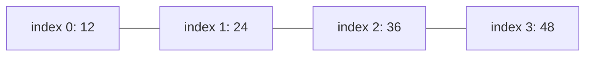


<details><summary><strong>View all 15 questions in this topic</strong></summary>

- [Q016. What is an array?](#q016)
- [Q017. How are arrays different from ArrayList?](#q017)
- [Q018. Why is random access in an array O(1)?](#q018)
- [Q019. What happens when you insert in the middle of an array?](#q019)
- [Q020. How do you reverse an array in place?](#q020)
- [Q021. How do you find the largest and second-largest distinct values?](#q021)
- [Q022. What is prefix sum?](#q022)
- [Q023. What is a difference array?](#q023)
- [Q024. What is the two-pointer technique?](#q024)
- [Q025. How do you remove duplicates from a sorted array in place?](#q025)
- [Q026. What is a sliding window?](#q026)
- [Q027. What is Kadane’s algorithm?](#q027)
- [Q028. How do you rotate an array by k positions?](#q028)
- [Q029. What is a 2D array and a jagged array?](#q029)
- [Q030. When is a circular array useful?](#q030)

</details>

<a id="q016"></a>
<details>
<summary><strong>Q016. What is an array?</strong></summary>

**Answer — in easy English:** An array stores a fixed number of elements of one declared type and allows indexed access. In Java, an array has a fixed length, and its elements are initialised to type defaults. It is useful when you need predictable indexed access.

**Example:** int[] marks = {60, 75, 90}; marks[1] is 75.

**Complexity:** Access O(1); linear search O(n); fixed length.

**🎯 Interview tip:** Index starts at 0, and out-of-range access throws ArrayIndexOutOfBoundsException.

</details>

<a id="q017"></a>
<details>
<summary><strong>Q017. How are arrays different from ArrayList?</strong></summary>

**Answer — in easy English:** A Java array has a fixed length and can store primitives directly. ArrayList is a resizable List of reference types, using a backing array internally. It offers convenient insert/remove methods but middle modifications shift elements.

**Example:** int[] a = new int[3]; List<Integer> b = new ArrayList<>();

**Complexity:** Get O(1); append amortised O(1); middle insert/remove O(n).

**🎯 Interview tip:** ArrayList<Integer> boxes int values; this has overhead.

</details>

<a id="q018"></a>
<details>
<summary><strong>Q018. Why is random access in an array O(1)?</strong></summary>

**Answer — in easy English:** The runtime calculates an element position from its base address, element size and index instead of scanning earlier elements. That address calculation takes a constant number of steps. Actual CPU/cache effects do not change its asymptotic bound.

**Example:** To read a[700], you do not iterate from a[0].

**Complexity:** O(1) access and assignment.

**🎯 Interview tip:** A linked list does not provide this guarantee.

</details>

<a id="q019"></a>
<details>
<summary><strong>Q019. What happens when you insert in the middle of an array?</strong></summary>

**Answer — in easy English:** If free capacity exists, all elements from the insertion index onward must shift right to make a gap. For a fixed full array, a larger array is required. Dynamic arrays automate resizing but still perform the shift.

**Example:** Insert 9 at index 1 in [2, 4, 6] becomes [2, 9, 4, 6].

**Complexity:** O(n) worst-case time; extra space depends on capacity.

**🎯 Interview tip:** ArrayList.add(index, item) is not O(1).

</details>

<a id="q020"></a>
<details>
<summary><strong>Q020. How do you reverse an array in place?</strong></summary>

**Answer — in easy English:** Use two pointers, one at the start and one at the end. Swap their values, move both towards the centre and stop when they meet. This avoids allocating a second array.

**Example:** Reverse [1, 2, 3, 4] to [4, 3, 2, 1].

**Complexity:** Time O(n), extra space O(1).

**🎯 Interview tip:** For odd length the centre element stays in place.

**Java snippet:**

```java
static void reverse(int[] a) {
    for (int l=0,r=a.length-1; l<r; l++,r--) {
        int t=a[l]; a[l]=a[r]; a[r]=t;
    }
}
```

</details>

<a id="q021"></a>
<details>
<summary><strong>Q021. How do you find the largest and second-largest distinct values?</strong></summary>

**Answer — in easy English:** Scan once while maintaining the largest and second-largest distinct values seen so far. Update both when a new maximum appears; update the second when the current value lies strictly between them. Decide how to handle arrays with fewer than two distinct values.

**Example:** For [7, 4, 7, 2], largest is 7 and second distinct largest is 4.

**Complexity:** Time O(n), extra space O(1).

**🎯 Interview tip:** Duplicates must not be counted as a distinct second-largest value.

</details>

<a id="q022"></a>
<details>
<summary><strong>Q022. What is prefix sum?</strong></summary>

**Answer — in easy English:** A prefix-sum array stores cumulative totals so any subarray sum can be calculated by subtracting two prefixes. Build prefix[0]=0 and prefix[i+1]=prefix[i]+a[i]. It is excellent when the array is static and there are many range-sum queries.

**Example:** For [2, 3, 5], sum of indices 1..2 is prefix[3]-prefix[1]=8.

**Complexity:** Build O(n); each range sum O(1); extra space O(n).

**🎯 Interview tip:** Use long for sums if int overflow is possible.

**Java snippet:**

```java
static long[] prefix(int[] a) {
    long[] p=new long[a.length+1];
    for(int i=0;i<a.length;i++) p[i+1]=p[i]+a[i];
    return p;
}
```

</details>

<a id="q023"></a>
<details>
<summary><strong>Q023. What is a difference array?</strong></summary>

**Answer — in easy English:** A difference array records changes between neighbouring positions. To add x to an inclusive interval [l,r], update diff[l]+=x and diff[r+1]-=x when that index exists. One final prefix scan reconstructs all updated values.

**Example:** Add 3 to indices 1..3 using two boundary updates instead of visiting three cells.

**Complexity:** Range update O(1); final reconstruction O(n).

**🎯 Interview tip:** This technique is for batch updates, not instant point reads after every update.

</details>

<a id="q024"></a>
<details>
<summary><strong>Q024. What is the two-pointer technique?</strong></summary>

**Answer — in easy English:** Two pointers track positions that move based on a condition, often from both ends or at different speeds. It can avoid nested loops when the input is sorted or a relationship can be maintained incrementally.

**Example:** In a sorted array, move left/right to find a pair with target sum.

**Complexity:** Often O(n) time and O(1) extra space.

**🎯 Interview tip:** Two-sum with opposing pointers normally requires sorted input.

</details>

<a id="q025"></a>
<details>
<summary><strong>Q025. How do you remove duplicates from a sorted array in place?</strong></summary>

**Answer — in easy English:** Keep a write index for the next distinct value. Scan from left to right, copying an element only when it differs from the last kept value. The first k slots then contain all unique elements.

**Example:** For [1, 1, 2, 2, 3], the first 3 slots become [1, 2, 3].

**Complexity:** O(n) time, O(1) auxiliary space.

**🎯 Interview tip:** The remaining slots after k are not part of the answer.

</details>

<a id="q026"></a>
<details>
<summary><strong>Q026. What is a sliding window?</strong></summary>

**Answer — in easy English:** A window represents a contiguous range of elements. Move its boundaries while maintaining a property such as sum, frequency or maximum. For fixed-size windows, remove the exiting element and add the entering element rather than recalculating from scratch.

**Example:** Maximum sum of 3 consecutive numbers in [1, 4, 2, 6] is 12.

**Complexity:** Fixed-size sum O(n) time, O(1) extra space.

**🎯 Interview tip:** For variable windows, confirm the property is monotonic before shrinking.

</details>

<a id="q027"></a>
<details>
<summary><strong>Q027. What is Kadane’s algorithm?</strong></summary>

**Answer — in easy English:** Kadane finds the maximum sum over a non-empty contiguous subarray. At every element, choose whether to start a new subarray there or extend the previous best ending there. Keep the best value seen across all endings.

**Example:** For [-2, 1, -3, 4, -1, 2], the answer is 5 from [4, -1, 2].

**Complexity:** O(n) time, O(1) extra space.

**🎯 Interview tip:** Initialise from the first element so all-negative arrays work.

**Java snippet:**

```java
static int maxSubarray(int[] a) {
    int cur=a[0], best=a[0];
    for(int i=1;i<a.length;i++){
        cur=Math.max(a[i],cur+a[i]);
        best=Math.max(best,cur);
    }
    return best;
}
```

</details>

<a id="q028"></a>
<details>
<summary><strong>Q028. How do you rotate an array by k positions?</strong></summary>

**Answer — in easy English:** Normalise k by the array length, then reverse the whole array, the first k elements, and the remainder for right rotation. This gives an in-place solution without a temporary array. Handle the empty array before taking modulo.

**Example:** Right-rotate [1, 2, 3, 4, 5] by 2 to [4, 5, 1, 2, 3].

**Complexity:** O(n) time and O(1) auxiliary space.

**🎯 Interview tip:** For negative k, normalise carefully based on requested rotation direction.

</details>

<a id="q029"></a>
<details>
<summary><strong>Q029. What is a 2D array and a jagged array?</strong></summary>

**Answer — in easy English:** A 2D Java array is actually an array of row arrays. Rows may have different lengths, making a jagged array possible. This differs from assuming every row has the same number of columns.

**Example:** int[][] rows = {{1,2}, {3}, {4,5,6}};

**Complexity:** Element access O(1) when both indices are valid.

**🎯 Interview tip:** Use rows[i].length, not rows[0].length, when row sizes may differ.

</details>

<a id="q030"></a>
<details>
<summary><strong>Q030. When is a circular array useful?</strong></summary>

**Answer — in easy English:** Circular indexing wraps around from the last position back to the first using modulo arithmetic or equivalent boundary checks. It supports fixed-capacity ring buffers and circular queues with efficient operations at the ends.

**Example:** Next index is (index+1)%capacity.

**Complexity:** Enqueue/dequeue O(1) when implemented with a ring buffer.

**🎯 Interview tip:** Track size or reserve one slot to distinguish full from empty.

</details>

[⬆ Back to topics](#-topics--question-count)

---

<a id="topic-03"></a>

## 🟢 03 · Strings & Character Structures

> **Focus:** Know when immutability, frequency counting and pattern matching matter.

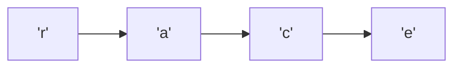


<details><summary><strong>View all 10 questions in this topic</strong></summary>

- [Q031. Why is String immutable in Java?](#q031)
- [Q032. When should you use StringBuilder?](#q032)
- [Q033. How can you check if a string is a palindrome?](#q033)
- [Q034. How do you find character frequencies?](#q034)
- [Q035. How do you check whether two strings are anagrams?](#q035)
- [Q036. What is run-length encoding?](#q036)
- [Q037. What is the difference between substring and subsequence?](#q037)
- [Q038. What is the KMP prefix-function or LPS array?](#q038)
- [Q039. What is rolling hash in string matching?](#q039)
- [Q040. How do you find the longest substring without repeated characters?](#q040)

</details>

<a id="q031"></a>
<details>
<summary><strong>Q031. Why is String immutable in Java?</strong></summary>

**Answer — in easy English:** Once created, a String value cannot be changed. Operations such as replace or concatenate create another string rather than editing the original. Immutability supports safe sharing, predictable hash codes and String pool reuse.

**Example:** String s="cat"; s.concat("s") leaves s as "cat" unless you assign the result.

**Complexity:** Length access O(1); building a modified string commonly O(n).

**🎯 Interview tip:** Do not use == for checking string content; use equals.

</details>

<a id="q032"></a>
<details>
<summary><strong>Q032. When should you use StringBuilder?</strong></summary>

**Answer — in easy English:** StringBuilder keeps a mutable buffer for repeated string modifications. It avoids creating a new immutable String after every append in a loop. Use it when many concatenations happen in one thread.

**Example:** Constructing a CSV row with append is simpler and efficient.

**Complexity:** Append amortised O(1) per char; total O(n) for n appended chars.

**🎯 Interview tip:** StringBuffer is synchronised; StringBuilder is generally preferred locally.

</details>

<a id="q033"></a>
<details>
<summary><strong>Q033. How can you check if a string is a palindrome?</strong></summary>

**Answer — in easy English:** Use pointers at the two ends and compare matching characters while moving inward. If the problem ignores case or punctuation, normalise or skip those characters before comparing. State whether Unicode code points matter.

**Example:** "level" is a palindrome; "hello" is not.

**Complexity:** Time O(n), extra space O(1) for char-based check.

**🎯 Interview tip:** Define whether spaces, case and punctuation count.

</details>

<a id="q034"></a>
<details>
<summary><strong>Q034. How do you find character frequencies?</strong></summary>

**Answer — in easy English:** Use an int array for a known small alphabet, or a HashMap for arbitrary characters. Scan the input once and increase the count of each character. Java char values are UTF-16 code units; full Unicode code-point counting requires codePoints().

**Example:** In "banana", a occurs 3 times, n occurs 2 times.

**Complexity:** O(n) time; O(k) space for k distinct symbols.

**🎯 Interview tip:** Choose indexing carefully for uppercase, emoji and non-ASCII text.

</details>

<a id="q035"></a>
<details>
<summary><strong>Q035. How do you check whether two strings are anagrams?</strong></summary>

**Answer — in easy English:** Two strings are anagrams when they contain the same characters with the same frequencies. Compare lengths first, then count characters in one string and subtract counts from the other. Ignore spaces/case only if the requirements say so.

**Example:** "listen" and "silent" are anagrams.

**Complexity:** O(n) time and O(k) frequency storage.

**🎯 Interview tip:** Sorting works too, but costs O(n log n).

</details>

<a id="q036"></a>
<details>
<summary><strong>Q036. What is run-length encoding?</strong></summary>

**Answer — in easy English:** Run-length encoding compresses consecutive identical characters into a symbol and count. It works well on strings with long runs and may expand data when runs are short. Encoding alone does not guarantee smaller output.

**Example:** "aaabb" can become "a3b2".

**Complexity:** O(n) time; output space O(number of runs).

**🎯 Interview tip:** Design an unambiguous format if input characters may contain digits.

</details>

<a id="q037"></a>
<details>
<summary><strong>Q037. What is the difference between substring and subsequence?</strong></summary>

**Answer — in easy English:** A substring is contiguous; a subsequence preserves order but can skip characters. This changes suitable solutions: fixed/variable windows help with substrings, while dynamic programming is common for subsequences.

**Example:** "bcd" is a substring of "abcde"; "ace" is a subsequence.

**Complexity:** Searching complexity depends on the algorithm.

**🎯 Interview tip:** Check the word contiguous in the problem statement.

</details>

<a id="q038"></a>
<details>
<summary><strong>Q038. What is the KMP prefix-function or LPS array?</strong></summary>

**Answer — in easy English:** KMP computes the longest proper prefix that is also a suffix for every pattern prefix. On mismatch, it uses this information to skip comparisons rather than restarting from the beginning. It gives linear pattern matching.

**Example:** Pattern "ababaca" has repeated prefixes that let KMP reuse partial matches.

**Complexity:** Preprocess O(m); search O(n); extra space O(m).

**🎯 Interview tip:** A proper prefix must be shorter than the complete string.

</details>

<a id="q039"></a>
<details>
<summary><strong>Q039. What is rolling hash in string matching?</strong></summary>

**Answer — in easy English:** Rolling hash maps a substring to a numeric fingerprint that can be updated efficiently as a window moves. Rabin–Karp first compares fingerprints and then verifies candidate matches because collisions are possible.

**Example:** Move from hash("abcd") to hash("bcde") without recomputing all characters.

**Complexity:** Expected O(n+m) typical; worst-case O(nm) with many collisions.

**🎯 Interview tip:** A hash match is not automatically proof of string equality.

</details>

<a id="q040"></a>
<details>
<summary><strong>Q040. How do you find the longest substring without repeated characters?</strong></summary>

**Answer — in easy English:** Maintain a moving window with each character’s latest index. If a repeated character lies inside the current window, move the left boundary just past its previous occurrence. Update the maximum window length each step.

**Example:** For "abcabcbb", the longest distinct-character substring has length 3.

**Complexity:** O(n) time and O(k) space for seen characters.

**🎯 Interview tip:** Move left only forwards; never move it backwards.

</details>

[⬆ Back to topics](#-topics--question-count)

---

<a id="topic-04"></a>

## 🟡 04 · Linked Lists

> **Focus:** Draw arrows before changing pointers; track head, tail and node identity.

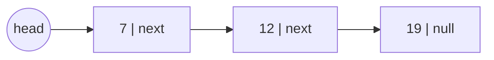


<details><summary><strong>View all 20 questions in this topic</strong></summary>

- [Q041. What is a singly linked list?](#q041)
- [Q042. What is a doubly linked list?](#q042)
- [Q043. What is a circular linked list?](#q043)
- [Q044. Array versus linked list: which is faster?](#q044)
- [Q045. How do you insert a node at the beginning?](#q045)
- [Q046. How do you insert at the end of a singly linked list?](#q046)
- [Q047. How do you delete a node by value?](#q047)
- [Q048. How do you reverse a singly linked list iteratively?](#q048)
- [Q049. How do you reverse a linked list recursively?](#q049)
- [Q050. How can you find the middle node?](#q050)
- [Q051. How do you detect a cycle in a linked list?](#q051)
- [Q052. How do you find the starting node of a cycle?](#q052)
- [Q053. How do you remove a cycle from a linked list?](#q053)
- [Q054. How do you merge two sorted linked lists?](#q054)
- [Q055. How do you remove the Nth node from the end?](#q055)
- [Q056. How do you check whether a linked list is a palindrome?](#q056)
- [Q057. How do you find the intersection of two linked lists?](#q057)
- [Q058. How do you clone a list with random pointers?](#q058)
- [Q059. What is an LRU cache and how is it implemented?](#q059)
- [Q060. How do you add two numbers stored in linked lists?](#q060)

</details>

<a id="q041"></a>
<details>
<summary><strong>Q041. What is a singly linked list?</strong></summary>

**Answer — in easy English:** A singly linked list is made of nodes holding a value and a reference to the next node. It can grow by allocating nodes without moving other elements, but indexed access requires traversing links from the head.

**Example:** head -> 7 -> 12 -> 19 -> null.

**Complexity:** Head insert O(1); find by index O(n).

**🎯 Interview tip:** Keep the head reference correct when changing the first node.

</details>

<a id="q042"></a>
<details>
<summary><strong>Q042. What is a doubly linked list?</strong></summary>

**Answer — in easy English:** Each node stores references to both previous and next nodes. Given a node, you can unlink it in constant time by updating neighbours, and traverse either direction. Extra references use more memory and need consistent updates.

**Example:** Browser back/forward history can be modelled with a doubly linked list.

**Complexity:** Remove known node O(1); search O(n).

**🎯 Interview tip:** Do not forget to fix both next and prev pointers.

</details>

<a id="q043"></a>
<details>
<summary><strong>Q043. What is a circular linked list?</strong></summary>

**Answer — in easy English:** In a circular list, the last node links to the first instead of null. It naturally models repeated cycles of items. Traversal requires an explicit stopping condition because a null sentinel may never appear.

**Example:** Round-robin players: A -> B -> C -> A.

**Complexity:** Insert after a known node O(1).

**🎯 Interview tip:** A while(node != null) loop can become infinite here.

</details>

<a id="q044"></a>
<details>
<summary><strong>Q044. Array versus linked list: which is faster?</strong></summary>

**Answer — in easy English:** Arrays excel at indexed reads and cache locality; linked lists support constant-time insertion next to a known node. If you must first locate that node, the traversal may dominate. Therefore compare complete workflows, not isolated operations.

**Example:** Inserting at the front of a singly linked list is O(1); reading its 500th node is O(n).

**Complexity:** Array get O(1), list get O(n); known-node list insertion O(1).

**🎯 Interview tip:** Java LinkedList is rarely a drop-in performance upgrade over ArrayList.

</details>

<a id="q045"></a>
<details>
<summary><strong>Q045. How do you insert a node at the beginning?</strong></summary>

**Answer — in easy English:** Create a node whose next points to the current head, then make it the new head. The order matters: preserve the old head before overwriting it. Empty lists work naturally because old head is null.

**Example:** Insert 3 into 5 -> 8 -> null to obtain 3 -> 5 -> 8 -> null.

**Complexity:** O(1) time and O(1) auxiliary space, excluding new node.

**🎯 Interview tip:** Do not lose the previous head reference.

</details>

<a id="q046"></a>
<details>
<summary><strong>Q046. How do you insert at the end of a singly linked list?</strong></summary>

**Answer — in easy English:** If the list maintains a tail reference, connect tail.next to the new node and update tail. Otherwise traverse until the last node before appending. An empty list needs both head and tail initialised.

**Example:** Append 11 to 4 -> 9 to obtain 4 -> 9 -> 11.

**Complexity:** O(1) with tail; otherwise O(n).

**🎯 Interview tip:** Update tail after deletion of the last node too.

</details>

<a id="q047"></a>
<details>
<summary><strong>Q047. How do you delete a node by value?</strong></summary>

**Answer — in easy English:** Search for the first matching node while remembering the preceding node. If the match is the head, change head; otherwise bypass the node using prev.next = current.next. Update tail if maintained.

**Example:** Delete 8 from 3 -> 8 -> 10 gives 3 -> 10.

**Complexity:** O(n) search time, O(1) extra space.

**🎯 Interview tip:** Decide whether to delete only the first match or every match.

</details>

<a id="q048"></a>
<details>
<summary><strong>Q048. How do you reverse a singly linked list iteratively?</strong></summary>

**Answer — in easy English:** Maintain previous, current and next references. Save current.next first, redirect current.next to previous, then advance. At the end previous is the new head; every link has been reversed in one pass.

**Example:** 1 -> 2 -> 3 becomes 3 -> 2 -> 1.

**Complexity:** O(n) time, O(1) auxiliary space.

**🎯 Interview tip:** Store next before rewiring or you may lose the remaining nodes.

**Java snippet:**

```java
static Node reverse(Node head) {
    Node prev=null,cur=head;
    while(cur!=null){
        Node next=cur.next; cur.next=prev;
        prev=cur; cur=next;
    }
    return prev;
}
```

</details>

<a id="q049"></a>
<details>
<summary><strong>Q049. How do you reverse a linked list recursively?</strong></summary>

**Answer — in easy English:** Reverse the sublist after the current node, then make the next node point back to the current node. Break the original forward link to avoid a cycle. The base case is null or a one-node list.

**Example:** reverse(1 -> 2 -> 3) returns head 3 with links 3 -> 2 -> 1.

**Complexity:** O(n) time, O(n) call-stack space.

**🎯 Interview tip:** An iterative version avoids stack overflow for very long lists.

</details>

<a id="q050"></a>
<details>
<summary><strong>Q050. How can you find the middle node?</strong></summary>

**Answer — in easy English:** Use slow and fast pointers. Slow advances one node and fast advances two. By the time fast reaches the end, slow is near the middle; with the common while(fast != null && fast.next != null) condition, even-length lists yield the second middle.

**Example:** For 1 -> 2 -> 3 -> 4, the returned middle is 3 with this convention.

**Complexity:** O(n) time, O(1) auxiliary space.

**🎯 Interview tip:** Mention which middle you return for even-sized lists.

</details>

<a id="q051"></a>
<details>
<summary><strong>Q051. How do you detect a cycle in a linked list?</strong></summary>

**Answer — in easy English:** Floyd’s tortoise-and-hare algorithm moves a slow pointer one step and a fast pointer two steps. If there is a cycle, they eventually meet. If fast reaches null, the list has no cycle.

**Example:** 1 -> 2 -> 3 -> 2 has a cycle and the pointers meet inside it.

**Complexity:** O(n) time, O(1) auxiliary space.

**🎯 Interview tip:** Check fast and fast.next before advancing two steps.

**Java snippet:**

```java
static boolean hasCycle(Node head) {
    Node slow=head,fast=head;
    while(fast!=null && fast.next!=null){
        slow=slow.next; fast=fast.next.next;
        if(slow==fast) return true;
    }
    return false;
}
```

</details>

<a id="q052"></a>
<details>
<summary><strong>Q052. How do you find the starting node of a cycle?</strong></summary>

**Answer — in easy English:** First find the slow/fast meeting point. Then start one pointer at head and leave the other at the meeting point; move both one step until they meet again. The meeting node is the cycle entrance due to the relative distances around the cycle.

**Example:** For 1 -> 2 -> 3 -> 4 -> 2, the entrance is node 2.

**Complexity:** O(n) time, O(1) auxiliary space.

**🎯 Interview tip:** Explain this only after proving a cycle exists.

</details>

<a id="q053"></a>
<details>
<summary><strong>Q053. How do you remove a cycle from a linked list?</strong></summary>

**Answer — in easy English:** Find the cycle entrance, then walk around the cycle to locate the node whose next points to the entrance. Set that next reference to null. If the structure maintains a tail, update it to this final node.

**Example:** 1 -> 2 -> 3 -> 2 becomes 1 -> 2 -> 3 -> null.

**Complexity:** O(n) time, O(1) extra space.

**🎯 Interview tip:** Handle a self-loop where a node points to itself.

</details>

<a id="q054"></a>
<details>
<summary><strong>Q054. How do you merge two sorted linked lists?</strong></summary>

**Answer — in easy English:** Use a dummy head and append the smaller current node from the two sorted input lists, moving that input pointer forward. After one list finishes, attach the remainder of the other. This relinks nodes rather than copying their values.

**Example:** 1 -> 4 and 2 -> 3 merge into 1 -> 2 -> 3 -> 4.

**Complexity:** O(n+m) time, O(1) extra space iteratively.

**🎯 Interview tip:** A dummy node removes special-case handling for the first element.

</details>

<a id="q055"></a>
<details>
<summary><strong>Q055. How do you remove the Nth node from the end?</strong></summary>

**Answer — in easy English:** Move fast n steps ahead, then move fast and slow together until fast reaches the end. A dummy node before head makes deletion of the original head easy. The target is the node after slow.

**Example:** For 10 -> 20 -> 30 -> 40 and n=2, delete 30.

**Complexity:** O(length) time and O(1) space.

**🎯 Interview tip:** Validate n before moving fast; n must be within list length.

</details>

<a id="q056"></a>
<details>
<summary><strong>Q056. How do you check whether a linked list is a palindrome?</strong></summary>

**Answer — in easy English:** Find the middle, reverse the second half, and compare values from the start and reversed half. Optionally reverse the second half again to restore the original list. This avoids storing all values in an array.

**Example:** 1 -> 2 -> 3 -> 2 -> 1 is a palindrome.

**Complexity:** O(n) time, O(1) auxiliary space.

**🎯 Interview tip:** Be clear whether the input list must be restored.

</details>

<a id="q057"></a>
<details>
<summary><strong>Q057. How do you find the intersection of two linked lists?</strong></summary>

**Answer — in easy English:** For two acyclic singly linked lists that share node identities, move pointers through both lists; when one hits null, redirect it to the other head. After equal total travel distances, they meet at the shared node or at null.

**Example:** A -> X -> Y and B -> C -> X -> Y intersect at the same X node.

**Complexity:** O(n+m) time, O(1) extra space.

**🎯 Interview tip:** Compare node references, not only node values.

</details>

<a id="q058"></a>
<details>
<summary><strong>Q058. How do you clone a list with random pointers?</strong></summary>

**Answer — in easy English:** Create one clone for each original node and keep a map from original to clone; then connect next and random references using that map. An alternative interleaves clone nodes into the original list, assigns random links, and separates them.

**Example:** Node A.random pointing to C must map to cloned C, not original C.

**Complexity:** Hash-map method O(n) time and O(n) extra space.

**🎯 Interview tip:** A shallow copy will incorrectly share original nodes.

</details>

<a id="q059"></a>
<details>
<summary><strong>Q059. What is an LRU cache and how is it implemented?</strong></summary>

**Answer — in easy English:** LRU evicts the least recently used key when capacity is full. Combine a hash map for key-to-node lookup with a doubly linked list ordered by recency. A get or put moves its node to the most-recent end.

**Example:** Capacity 2: put(A), put(B), get(A), put(C) evicts B.

**Complexity:** Get and put O(1) average; O(capacity) storage.

**🎯 Interview tip:** Java LinkedHashMap(accessOrder=true) can simplify implementation.

</details>

<a id="q060"></a>
<details>
<summary><strong>Q060. How do you add two numbers stored in linked lists?</strong></summary>

**Answer — in easy English:** When digits are stored in reverse order, traverse both lists together, adding matching digits plus a carry. Create one output node for sum%10 and carry sum/10, and continue until both lists and carry are exhausted. The dummy-head technique makes output construction simple.

**Example:** 342 is stored as 2 -> 4 -> 3 and 465 as 5 -> 6 -> 4; their sum 807 becomes 7 -> 0 -> 8.

**Complexity:** O(max(n,m)) time; O(max(n,m)) output nodes.

**🎯 Interview tip:** State digit order, leading-zero rules and how leftover carry is handled.

</details>

[⬆ Back to topics](#-topics--question-count)

---

<a id="topic-05"></a>

## 🟡 05 · Stacks & Monotonic Stacks

> **Focus:** Look for LIFO behaviour, nesting, nearest elements and histogram boundaries.

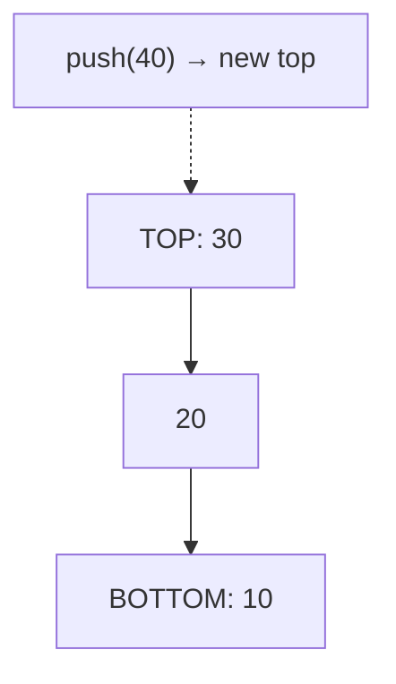


<details><summary><strong>View all 15 questions in this topic</strong></summary>

- [Q061. What is a stack?](#q061)
- [Q062. How do you implement a stack using an array?](#q062)
- [Q063. How do you implement a stack using a linked list?](#q063)
- [Q064. Which Java class should you use for a stack?](#q064)
- [Q065. How do you validate balanced parentheses?](#q065)
- [Q066. How do you reverse a string with a stack?](#q066)
- [Q067. What is a monotonic stack?](#q067)
- [Q068. How do you find the next greater element?](#q068)
- [Q069. What is the stock span problem?](#q069)
- [Q070. How do you find the largest rectangle in a histogram?](#q070)
- [Q071. How do you evaluate a postfix expression?](#q071)
- [Q072. How do you convert infix to postfix?](#q072)
- [Q073. What is a Min Stack?](#q073)
- [Q074. How do you implement a queue using two stacks?](#q074)
- [Q075. What is the difference between the call stack and a manual stack?](#q075)

</details>

<a id="q061"></a>
<details>
<summary><strong>Q061. What is a stack?</strong></summary>

**Answer — in easy English:** A stack follows Last In, First Out (LIFO): the last item added is the first removed. Core operations are push, pop and peek. It is used to model nested work, undo actions and expression evaluation.

**Example:** Push 2, then 5; pop returns 5.

**Complexity:** Push, pop and peek O(1) with a suitable implementation.

**🎯 Interview tip:** Pop from an empty stack should be checked.

</details>

<a id="q062"></a>
<details>
<summary><strong>Q062. How do you implement a stack using an array?</strong></summary>

**Answer — in easy English:** Maintain a top index pointing to the last occupied cell. Push increments top then writes; pop reads then decrements. With a fixed array, reject push when capacity is reached.

**Example:** After push(4), push(9), the top points at 9.

**Complexity:** O(1) for push, pop and peek; O(capacity) storage.

**🎯 Interview tip:** Define overflow and underflow behaviour explicitly.

</details>

<a id="q063"></a>
<details>
<summary><strong>Q063. How do you implement a stack using a linked list?</strong></summary>

**Answer — in easy English:** Treat the list head as the stack top. Push creates a new head node, and pop removes the head. No shifting occurs, so both operations are constant time.

**Example:** head -> 8 -> 5; push(2) becomes head -> 2 -> 8 -> 5.

**Complexity:** O(1) push/pop, O(n) total node storage.

**🎯 Interview tip:** A linked implementation carries per-node allocation overhead.

</details>

<a id="q064"></a>
<details>
<summary><strong>Q064. Which Java class should you use for a stack?</strong></summary>

**Answer — in easy English:** Prefer the Deque interface, commonly implemented by ArrayDeque, for single-threaded stack operations. It provides push, pop and peek without the legacy Stack class design. Avoid null entries in ArrayDeque.

**Example:** Deque<Integer> st = new ArrayDeque<>(); st.push(7);

**Complexity:** O(1) amortised push/pop for ArrayDeque.

**🎯 Interview tip:** Use java.util.Stack only when a legacy API requires it.

**Java snippet:**

```java
Deque<Integer> st = new ArrayDeque<>();
st.push(10); st.push(20);
System.out.println(st.pop()); // 20
```

</details>

<a id="q065"></a>
<details>
<summary><strong>Q065. How do you validate balanced parentheses?</strong></summary>

**Answer — in easy English:** Push opening brackets onto a stack. For each closing bracket, require a matching opening bracket at the top; otherwise reject immediately. The input is valid only if no brackets are left unmatched at the end.

**Example:** "{[()]}" is valid; "{[(])}" is not.

**Complexity:** O(n) time and O(n) worst-case space.

**🎯 Interview tip:** Matching only counts is insufficient because ordering matters.

</details>

<a id="q066"></a>
<details>
<summary><strong>Q066. How do you reverse a string with a stack?</strong></summary>

**Answer — in easy English:** Push each character, then pop all characters into an output builder. Because a stack reverses insertion order, the output is reversed. In Java, StringBuilder.reverse() is simpler for ordinary reversal.

**Example:** "JAVA" becomes "AVAJ".

**Complexity:** O(n) time and O(n) extra space with a stack.

**🎯 Interview tip:** Unicode surrogate pairs need care when reversing by char.

</details>

<a id="q067"></a>
<details>
<summary><strong>Q067. What is a monotonic stack?</strong></summary>

**Answer — in easy English:** A monotonic stack stores elements in increasing or decreasing order, discarding candidates that can never be useful for future comparisons. It is widely used for nearest greater/smaller element and histogram questions.

**Example:** While processing [2, 1, 4], an increasing stack removes larger values before pushing 1.

**Complexity:** Often O(n) total time because each element is pushed and popped once.

**🎯 Interview tip:** Define whether equality should cause a pop for the problem.

</details>

<a id="q068"></a>
<details>
<summary><strong>Q068. How do you find the next greater element?</strong></summary>

**Answer — in easy English:** Scan values from right to left while maintaining a decreasing stack of candidate greater values. Pop anything less than or equal to the current value. The remaining top, if present, is the next greater value to the right.

**Example:** For [2, 1, 3], next greater answers are [3, 3, -1].

**Complexity:** O(n) time and O(n) space.

**🎯 Interview tip:** If you need the next greater index, store indices instead of values.

**Java snippet:**

```java
static int[] nextGreater(int[] a){
    int[] ans=new int[a.length];
    Deque<Integer> st=new ArrayDeque<>();
    for(int i=a.length-1;i>=0;i--){
        while(!st.isEmpty() && st.peek()<=a[i]) st.pop();
        ans[i]=st.isEmpty()?-1:st.peek(); st.push(a[i]);
    }
    return ans;
}
```

</details>

<a id="q069"></a>
<details>
<summary><strong>Q069. What is the stock span problem?</strong></summary>

**Answer — in easy English:** For each day, stock span counts consecutive previous days, including today, whose price is at most today’s price. Use a decreasing stack of indices; pop earlier prices not greater than the current price.

**Example:** Prices [100, 80, 60, 70] have spans [1, 1, 1, 2].

**Complexity:** O(n) total time, O(n) space.

**🎯 Interview tip:** Equal prices are included in the span, so pop using <=.

</details>

<a id="q070"></a>
<details>
<summary><strong>Q070. How do you find the largest rectangle in a histogram?</strong></summary>

**Answer — in easy English:** Use an increasing stack of bar indices. When a shorter bar arrives, pop taller bars and compute each popped bar’s maximum width based on the current position and new stack top. Add a final zero-height sentinel to flush the stack.

**Example:** For heights [2, 1, 5, 6, 2, 3], largest area is 10.

**Complexity:** O(n) time and O(n) space.

**🎯 Interview tip:** Width is bounded by the nearest strictly smaller bars on both sides.

</details>

<a id="q071"></a>
<details>
<summary><strong>Q071. How do you evaluate a postfix expression?</strong></summary>

**Answer — in easy English:** Read tokens left to right; push numbers, and when an operator appears pop its required operands, compute the result and push it back. At the end one value should remain.

**Example:** "2 3 4 * +" evaluates as 2+(3*4)=14.

**Complexity:** O(n) time and O(n) stack space.

**🎯 Interview tip:** For subtraction and division, the first popped value is the right operand.

</details>

<a id="q072"></a>
<details>
<summary><strong>Q072. How do you convert infix to postfix?</strong></summary>

**Answer — in easy English:** Use an operator stack to handle precedence and parentheses. Output operands immediately; before pushing an operator, pop operators with higher or applicable equal precedence. Parentheses control when operators are released.

**Example:** "A+B*C" becomes "ABC*+".

**Complexity:** O(n) time and O(n) extra space.

**🎯 Interview tip:** Exponentiation is typically right-associative, unlike addition.

</details>

<a id="q073"></a>
<details>
<summary><strong>Q073. What is a Min Stack?</strong></summary>

**Answer — in easy English:** A Min Stack supports push, pop and retrieving the minimum value in constant time. Store the current minimum alongside every pushed value, or maintain a second stack of historical minima. On pop, restore the previous minimum automatically.

**Example:** Push 5, 2, 7; min is 2. Pop 7; min stays 2.

**Complexity:** All operations O(1); space O(n).

**🎯 Interview tip:** Handle repeated equal minima correctly.

</details>

<a id="q074"></a>
<details>
<summary><strong>Q074. How do you implement a queue using two stacks?</strong></summary>

**Answer — in easy English:** Keep an input stack for enqueue and an output stack for dequeue. When output is empty, transfer every item from input to output, reversing order. Each item is moved only a constant number of times overall.

**Example:** Enqueue 1, 2, 3; first dequeue returns 1 after one transfer.

**Complexity:** Enqueue O(1); dequeue amortised O(1); worst single dequeue O(n).

**🎯 Interview tip:** Do not transfer on every dequeue: only refill when output is empty.

</details>

<a id="q075"></a>
<details>
<summary><strong>Q075. What is the difference between the call stack and a manual stack?</strong></summary>

**Answer — in easy English:** The call stack is controlled by the runtime and records active function calls, local variables and return addresses. A manual stack is a programmer-managed container stored as regular objects or arrays. Iterative DFS uses a manual stack to avoid deep recursion.

**Example:** Recursive tree DFS uses stack frames; iterative DFS uses ArrayDeque nodes.

**Complexity:** Both can use O(depth) storage, but resource limits differ.

**🎯 Interview tip:** Manual stacks allow explicit control over memory and traversal order.

</details>

[⬆ Back to topics](#-topics--question-count)

---

<a id="topic-06"></a>

## 🟡 06 · Queues, Deques & Scheduling

> **Focus:** Distinguish FIFO, double-ended operations, backpressure and monotonic windows.

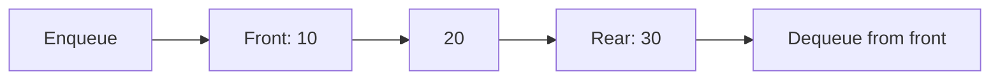


<details><summary><strong>View all 15 questions in this topic</strong></summary>

- [Q076. What is a queue?](#q076)
- [Q077. How do you implement a queue using a circular array?](#q077)
- [Q078. What is a deque?](#q078)
- [Q079. What is the difference between Queue and PriorityQueue?](#q079)
- [Q080. What is a monotonic deque?](#q080)
- [Q081. How do you compute sliding-window maximum?](#q081)
- [Q082. How do you implement a stack using queues?](#q082)
- [Q083. What is a blocking queue?](#q083)
- [Q084. What is producer–consumer with a queue?](#q084)
- [Q085. What is a circular queue used for?](#q085)
- [Q086. How does BFS use a queue?](#q086)
- [Q087. What is round-robin scheduling?](#q087)
- [Q088. What is the difference between a deque and linked list?](#q088)
- [Q089. How would you design a recent-events buffer?](#q089)
- [Q090. How do you solve first non-repeating character in a stream?](#q090)

</details>

<a id="q076"></a>
<details>
<summary><strong>Q076. What is a queue?</strong></summary>

**Answer — in easy English:** A queue follows First In, First Out (FIFO): the earliest inserted item is removed first. Enqueue adds at the rear and dequeue removes from the front. Queues naturally model waiting tasks and breadth-first traversal.

**Example:** Customers A, B, C arrive; A gets served first.

**Complexity:** Enqueue/dequeue O(1) with linked or ring-buffer implementation.

**🎯 Interview tip:** Do not implement dequeue using ArrayList.remove(0) for heavy workloads.

</details>

<a id="q077"></a>
<details>
<summary><strong>Q077. How do you implement a queue using a circular array?</strong></summary>

**Answer — in easy English:** Maintain front, size and fixed capacity. Enqueue writes at (front+size)%capacity; dequeue reads front and advances it modulo capacity. Track size to distinguish empty and full states.

**Example:** Capacity 3: after removing first item, a new item can wrap to index 0.

**Complexity:** O(1) enqueue/dequeue; O(capacity) storage.

**🎯 Interview tip:** Test wrap-around and full-to-empty transitions.

</details>

<a id="q078"></a>
<details>
<summary><strong>Q078. What is a deque?</strong></summary>

**Answer — in easy English:** A double-ended queue supports insertion and removal at both front and back. It can behave like a queue or stack, and is powerful for sliding-window maximum and palindrome processing.

**Example:** AddFirst(1), addLast(2), removeLast() returns 2.

**Complexity:** Typically O(1) operations at both ends.

**🎯 Interview tip:** Deque is pronounced “deck”; in Java use ArrayDeque for many cases.

</details>

<a id="q079"></a>
<details>
<summary><strong>Q079. What is the difference between Queue and PriorityQueue?</strong></summary>

**Answer — in easy English:** An ordinary queue removes items in arrival order, while a priority queue removes the item with the highest scheduling priority according to its comparator or natural order. Java PriorityQueue is a min-priority queue by default.

**Example:** Add 9, 2, 5: a FIFO queue removes 9; a min-priority queue removes 2.

**Complexity:** PriorityQueue offer/poll O(log n); peek O(1).

**🎯 Interview tip:** Iteration of PriorityQueue does not produce sorted order.

</details>

<a id="q080"></a>
<details>
<summary><strong>Q080. What is a monotonic deque?</strong></summary>

**Answer — in easy English:** A monotonic deque maintains candidates in decreasing or increasing order while also discarding elements outside a moving window. The front is the best candidate for the current window.

**Example:** For maximum, remove smaller values from the back before appending the new index.

**Complexity:** O(n) total work over n elements.

**🎯 Interview tip:** Store indices so you can evict expired elements.

</details>

<a id="q081"></a>
<details>
<summary><strong>Q081. How do you compute sliding-window maximum?</strong></summary>

**Answer — in easy English:** Keep a decreasing deque of element indices. Remove front indices that fall outside the window, then remove from the back indices whose values are no larger than the new value. The front points to the window maximum.

**Example:** For [1, 3, -1, -3, 5] with k=3, maxima are [3, 3, 5].

**Complexity:** O(n) time; O(k) deque space.

**🎯 Interview tip:** Always expire old indices before reading the answer.

**Java snippet:**

```java
static int[] windowMax(int[] a,int k){
    if(k<1 || k>a.length) throw new IllegalArgumentException();
    int[] out=new int[a.length-k+1];
    Deque<Integer> d=new ArrayDeque<>();
    for(int i=0;i<a.length;i++){
        while(!d.isEmpty() && d.peekFirst()<=i-k) d.removeFirst();
        while(!d.isEmpty() && a[d.peekLast()]<=a[i]) d.removeLast();
        d.addLast(i);
        if(i>=k-1) out[i-k+1]=a[d.peekFirst()];
    } return out;
}
```

</details>

<a id="q082"></a>
<details>
<summary><strong>Q082. How do you implement a stack using queues?</strong></summary>

**Answer — in easy English:** One common method uses a single queue: after pushing a new item, rotate all older elements to the back so the new item becomes front. Pop then simply removes from the front. Another method uses two queues and changes costs.

**Example:** Push 3 then 7, rotate, and dequeue returns 7 first.

**Complexity:** Push O(n) and pop O(1) in the rotating approach.

**🎯 Interview tip:** Be explicit which operation is made expensive.

</details>

<a id="q083"></a>
<details>
<summary><strong>Q083. What is a blocking queue?</strong></summary>

**Answer — in easy English:** A blocking queue lets consumer threads wait when no item is available and producer threads wait when a bounded queue is full. It supports coordinated producer–consumer pipelines without manual busy-wait loops.

**Example:** Java ArrayBlockingQueue<>(100) blocks on put/take as needed.

**Complexity:** Queue operations generally O(1); waiting time depends on contention.

**🎯 Interview tip:** Use the java.util.concurrent classes for cross-thread communication.

</details>

<a id="q084"></a>
<details>
<summary><strong>Q084. What is producer–consumer with a queue?</strong></summary>

**Answer — in easy English:** Producers create work items and put them in a shared queue; consumers remove and process them. A bounded blocking queue provides backpressure so producers cannot overwhelm memory when consumers are slow.

**Example:** A web crawler can queue fetched pages for parsing workers.

**Complexity:** Work throughput depends on task cost and worker count.

**🎯 Interview tip:** Have a termination strategy such as poison pills or interruption.

</details>

<a id="q085"></a>
<details>
<summary><strong>Q085. What is a circular queue used for?</strong></summary>

**Answer — in easy English:** A circular queue reuses a fixed buffer by wrapping indices around. It is useful for streaming data, telemetry, device buffers and embedded systems because allocations can be avoided after setup.

**Example:** A ring buffer with capacity 8 continuously stores the latest incoming events.

**Complexity:** O(1) per operation in a fixed ring buffer.

**🎯 Interview tip:** Clearly define behaviour on full capacity: block, reject or overwrite.

</details>

<a id="q086"></a>
<details>
<summary><strong>Q086. How does BFS use a queue?</strong></summary>

**Answer — in easy English:** BFS starts at a source vertex, enqueues it, then repeatedly removes a vertex and enqueues its unvisited neighbours. FIFO order processes vertices layer by layer, finding shortest paths by number of edges in unweighted graphs.

**Example:** Starting at A, visit distance-1 neighbours before distance-2 neighbours.

**Complexity:** O(V+E) time with adjacency lists and O(V) space.

**🎯 Interview tip:** Mark visited when enqueuing to avoid duplicate entries.

</details>

<a id="q087"></a>
<details>
<summary><strong>Q087. What is round-robin scheduling?</strong></summary>

**Answer — in easy English:** Round-robin scheduling cycles through ready tasks and gives each a limited execution time slice. Unfinished tasks return to the back of the queue. It improves fairness but may increase context-switch overhead.

**Example:** Tasks P1, P2, P3 each receive a 10 ms slice in turn.

**Complexity:** Queue rotation O(1); system cost depends on tasks and time quantum.

**🎯 Interview tip:** Time quantum strongly affects latency and overhead.

</details>

<a id="q088"></a>
<details>
<summary><strong>Q088. What is the difference between a deque and linked list?</strong></summary>

**Answer — in easy English:** Deque is an interface describing operations at both ends; a linked list is an implementation structure. Java ArrayDeque provides efficient deque operations with an array, while LinkedList provides List and Deque interfaces with nodes.

**Example:** For queue-style use, ArrayDeque often has lower overhead than LinkedList.

**Complexity:** Both give O(1) end operations in typical implementations.

**🎯 Interview tip:** Interfaces describe capabilities; implementations determine costs.

</details>

<a id="q089"></a>
<details>
<summary><strong>Q089. How would you design a recent-events buffer?</strong></summary>

**Answer — in easy English:** Use a fixed-capacity ring buffer if you only need the last N events. Each new event overwrites or evicts the oldest one, keeping memory bounded. If event timestamps are important, store them with each payload.

**Example:** Keep latest 100 log messages for a dashboard widget.

**Complexity:** Insert O(1); read all events O(N).

**🎯 Interview tip:** Define whether overwrite is allowed when the buffer is full.

</details>

<a id="q090"></a>
<details>
<summary><strong>Q090. How do you solve first non-repeating character in a stream?</strong></summary>

**Answer — in easy English:** Keep a frequency map for each observed character and a queue of arrival candidates. After each new character, remove from the front while its frequency is more than one. The remaining front is the first non-repeating character.

**Example:** Stream "aabc" produces a, none, b, b.

**Complexity:** Amortised O(1) processing per item under constant-time hash operations.

**🎯 Interview tip:** A character may appear only once in the queue but its frequency can rise.

</details>

[⬆ Back to topics](#-topics--question-count)

---

<a id="topic-07"></a>

## 🟡 07 · Hash Tables, Sets & Maps

> **Focus:** Hashing speeds up equality lookup but does not preserve natural sorted order.

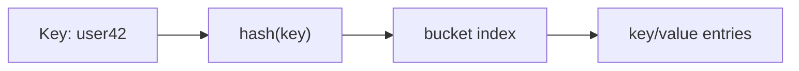


<details><summary><strong>View all 15 questions in this topic</strong></summary>

- [Q091. What is hashing?](#q091)
- [Q092. What is a hash collision?](#q092)
- [Q093. What is separate chaining?](#q093)
- [Q094. What is open addressing?](#q094)
- [Q095. What is load factor in a hash table?](#q095)
- [Q096. HashMap versus HashSet: what is the difference?](#q096)
- [Q097. HashMap versus TreeMap: when should you choose each?](#q097)
- [Q098. What is LinkedHashMap?](#q098)
- [Q099. How do equals() and hashCode() work together?](#q099)
- [Q100. How do you solve Two Sum using a map?](#q100)
- [Q101. How do you group anagrams?](#q101)
- [Q102. How do you find the longest consecutive sequence?](#q102)
- [Q103. What is a Bloom filter?](#q103)
- [Q104. What is consistent hashing?](#q104)
- [Q105. What is a Count-Min Sketch?](#q105)

</details>

<a id="q091"></a>
<details>
<summary><strong>Q091. What is hashing?</strong></summary>

**Answer — in easy English:** Hashing maps a key to a numeric hash code used to select a storage bucket. A good hash function spreads keys evenly so lookup, insertion and deletion are usually fast. Equal keys must produce equal hash codes.

**Example:** Map "alice" to a bucket using its hashCode().

**Complexity:** Average O(1) lookup/update with a well-behaved hash table.

**🎯 Interview tip:** Hashing is not encryption and does not make values secret.

</details>

<a id="q092"></a>
<details>
<summary><strong>Q092. What is a hash collision?</strong></summary>

**Answer — in easy English:** A collision occurs when two different keys map to the same bucket or hash value. Hash tables must resolve collisions while preserving access to both entries. Collisions are normal; correctness depends on equality checks.

**Example:** Keys 12 and 22 may choose the same bucket when table size is 10.

**Complexity:** Large collision chains can degrade performance.

**🎯 Interview tip:** Never assume distinct keys always have distinct hashes.

</details>

<a id="q093"></a>
<details>
<summary><strong>Q093. What is separate chaining?</strong></summary>

**Answer — in easy English:** Separate chaining stores multiple entries associated with the same bucket, often in linked structures or tree bins. A lookup checks matching keys within that bucket. Performance depends on load factor and collision distribution.

**Example:** Bucket 3 may hold (A,1), (B,2), (C,3).

**Complexity:** Average O(1); O(n) worst case in generic chaining.

**🎯 Interview tip:** Java HashMap may treeify large bins under implementation-specific conditions.

</details>

<a id="q094"></a>
<details>
<summary><strong>Q094. What is open addressing?</strong></summary>

**Answer — in easy English:** Open addressing stores all entries in the table itself. On collision it probes alternative positions using a strategy such as linear, quadratic or double hashing. Deletion often requires tombstones so searches remain correct.

**Example:** Try index h, then h+1, h+2 until an empty slot is found.

**Complexity:** Expected O(1) at low load; worst-case O(n).

**🎯 Interview tip:** Performance falls as the table becomes full.

</details>

<a id="q095"></a>
<details>
<summary><strong>Q095. What is load factor in a hash table?</strong></summary>

**Answer — in easy English:** Load factor measures how full a table is, commonly entries divided by bucket count. A high load factor increases collisions, while a low one wastes memory. Many hash maps resize when a configured threshold is crossed.

**Example:** 100 entries / 200 buckets = load factor 0.5.

**Complexity:** Resizing costs O(n) but insert is often amortised O(1).

**🎯 Interview tip:** Thresholds and resizing rules vary by implementation.

</details>

<a id="q096"></a>
<details>
<summary><strong>Q096. HashMap versus HashSet: what is the difference?</strong></summary>

**Answer — in easy English:** HashMap associates each unique key with a value. HashSet stores only unique elements and is conceptually backed by a map-like membership structure. Use a set when only existence matters.

**Example:** Count words with Map<String,Integer>; store unique words with Set<String>.

**Complexity:** Expected O(1) put/get/contains.

**🎯 Interview tip:** Do not confuse map values, which may repeat, with unique keys.

</details>

<a id="q097"></a>
<details>
<summary><strong>Q097. HashMap versus TreeMap: when should you choose each?</strong></summary>

**Answer — in easy English:** HashMap offers average constant-time operations without sorted iteration. TreeMap maintains keys in sorted order using a balanced search tree, providing order queries such as floorKey and ceilingKey.

**Example:** Use TreeMap for next available booking slot by timestamp.

**Complexity:** HashMap average O(1); TreeMap O(log n).

**🎯 Interview tip:** TreeMap key comparison must be consistent with desired key identity.

</details>

<a id="q098"></a>
<details>
<summary><strong>Q098. What is LinkedHashMap?</strong></summary>

**Answer — in easy English:** LinkedHashMap maintains a predictable encounter order, usually insertion order; it can also maintain access order. It combines hash lookup with a doubly linked ordering structure, which makes it useful for LRU caches.

**Example:** Iterating insertion-order map yields keys in insertion sequence.

**Complexity:** Average O(1) get/put with extra per-entry memory.

**🎯 Interview tip:** Access-order iteration changes after a get.

</details>

<a id="q099"></a>
<details>
<summary><strong>Q099. How do equals() and hashCode() work together?</strong></summary>

**Answer — in easy English:** If two objects are equal according to equals(), they must have the same hashCode(). Unequal objects are allowed to share a hash. Violating this contract can make lookups fail after an object was inserted into a hash-based collection.

**Example:** Two Student objects with the same logical ID must hash consistently.

**Complexity:** Hash-based lookup is expected O(1), assuming stable keys.

**🎯 Interview tip:** Do not mutate fields used in equals/hashCode while an object is a map key.

</details>

<a id="q100"></a>
<details>
<summary><strong>Q100. How do you solve Two Sum using a map?</strong></summary>

**Answer — in easy English:** Scan each number and calculate the complement target-current. If that complement is already stored with an earlier index, return the pair. Otherwise store the current number and index for future matches.

**Example:** In [2, 7, 11] with target 9, return indices [0, 1].

**Complexity:** O(n) expected time, O(n) additional space.

**🎯 Interview tip:** Check the complement before inserting to avoid using one element twice.

**Java snippet:**

```java
static int[] twoSum(int[] a,int target){
    Map<Integer,Integer> seen=new HashMap<>();
    for(int i=0;i<a.length;i++){
        int need=target-a[i];
        if(seen.containsKey(need)) return new int[]{seen.get(need),i};
        seen.put(a[i],i);
    } return new int[0];
}
```

</details>

<a id="q101"></a>
<details>
<summary><strong>Q101. How do you group anagrams?</strong></summary>

**Answer — in easy English:** Compute a canonical key for each string, such as its sorted characters or a frequency signature. Put strings with the same key into the same map bucket. Each group then contains anagrams.

**Example:** "eat", "tea" and "ate" share a canonical key.

**Complexity:** Sorting-key approach O(N·L log L) for N words of max length L.

**🎯 Interview tip:** Frequency signatures must encode characters without ambiguity.

</details>

<a id="q102"></a>
<details>
<summary><strong>Q102. How do you find the longest consecutive sequence?</strong></summary>

**Answer — in easy English:** Add all numbers to a set. Start counting a run only when num-1 is absent, meaning the number begins a sequence. Extend while subsequent numbers exist. Each value participates in only constant expected work.

**Example:** For [100, 4, 200, 1, 3, 2], longest run is [1,2,3,4], length 4.

**Complexity:** Expected O(n) time and O(n) space.

**🎯 Interview tip:** Watch integer overflow if incrementing Integer.MAX_VALUE.

</details>

<a id="q103"></a>
<details>
<summary><strong>Q103. What is a Bloom filter?</strong></summary>

**Answer — in easy English:** A Bloom filter is a compact probabilistic membership structure backed by bits and multiple hash functions. It can give false positives but not false negatives for inserted items, assuming standard operation without deletion. It is useful before an expensive database lookup.

**Example:** If Bloom says absent, skip storage lookup; if present, verify in storage.

**Complexity:** Insert/query O(k) hashes; space O(m) bits.

**🎯 Interview tip:** A positive result means maybe present, not definitely present.

</details>

<a id="q104"></a>
<details>
<summary><strong>Q104. What is consistent hashing?</strong></summary>

**Answer — in easy English:** Consistent hashing assigns nodes and keys to positions on a circular hash space. A key belongs to a nearby node on the ring. When nodes join or leave, fewer keys move compared with simple modulo hashing.

**Example:** A distributed cache can map user sessions to the next node clockwise.

**Complexity:** Lookup O(log N) with sorted node positions.

**🎯 Interview tip:** Virtual nodes help distribute uneven key loads.

</details>

<a id="q105"></a>
<details>
<summary><strong>Q105. What is a Count-Min Sketch?</strong></summary>

**Answer — in easy English:** Count-Min Sketch approximates frequency counts with a small two-dimensional counter array and several hash functions. It never underestimates under its normal insertion-only model but may overestimate because of collisions. It is good for high-volume streams.

**Example:** Estimate how often a search phrase appears without storing every distinct phrase.

**Complexity:** Update/query O(d) for d hash rows; space O(w·d).

**🎯 Interview tip:** Approximate counts are not suitable when exact billing numbers are required.

</details>

[⬆ Back to topics](#-topics--question-count)

---

<a id="topic-08"></a>

## 🟡 08 · Recursion, Backtracking & Memory

> **Focus:** Explain base case, shrinking subproblem and maximum simultaneous stack depth.

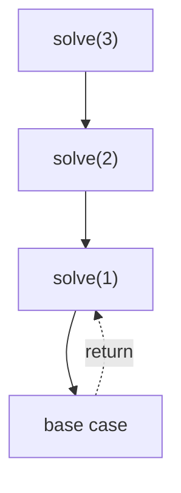


<details><summary><strong>View all 10 questions in this topic</strong></summary>

- [Q106. What is a recursive base case?](#q106)
- [Q107. What is tail recursion?](#q107)
- [Q108. What is backtracking?](#q108)
- [Q109. How do you generate subsets?](#q109)
- [Q110. How do you generate permutations?](#q110)
- [Q111. What is memoisation?](#q111)
- [Q112. What is the difference between DFS recursion and iterative DFS?](#q112)
- [Q113. How do you estimate recursive space complexity?](#q113)
- [Q114. What is a recursion tree?](#q114)
- [Q115. What is pruning in backtracking?](#q115)

</details>

<a id="q106"></a>
<details>
<summary><strong>Q106. What is a recursive base case?</strong></summary>

**Answer — in easy English:** The base case is a condition that stops recursive calls and returns a known result. Without it or without progress toward it, recursion can continue until the stack overflows. A correct recursive proof usually has a base case and an inductive step.

**Example:** factorial(0) returns 1; factorial(n) calls factorial(n-1).

**Complexity:** Complexity depends on call tree and depth.

**🎯 Interview tip:** Verify both termination and correctness.

</details>

<a id="q107"></a>
<details>
<summary><strong>Q107. What is tail recursion?</strong></summary>

**Answer — in easy English:** A function is tail-recursive when its recursive call is the last action before return. Some languages optimise such calls, but Java does not guarantee tail-call optimisation, so deep tail recursion can still overflow its stack.

**Example:** An accumulator-based factorial makes the recursive call the final step.

**Complexity:** Factorial remains O(n) time and O(n) stack in typical Java execution.

**🎯 Interview tip:** Prefer a loop when stack depth may be very large.

</details>

<a id="q108"></a>
<details>
<summary><strong>Q108. What is backtracking?</strong></summary>

**Answer — in easy English:** Backtracking explores candidate solutions by making a choice, recursively exploring, and undoing that choice before trying another. It prunes branches as soon as they violate the problem’s constraints.

**Example:** Try a number in Sudoku, recurse, then clear it if the path fails.

**Complexity:** Worst-case often exponential; space proportional to recursion depth and state.

**🎯 Interview tip:** Write choose → explore → undo clearly.

</details>

<a id="q109"></a>
<details>
<summary><strong>Q109. How do you generate subsets?</strong></summary>

**Answer — in easy English:** At each index choose whether to include the current element. These two branches produce all subsets of a set of n distinct elements. Another method iterates bit masks from 0 through 2^n-1.

**Example:** For [1,2], subsets are [], [1], [2], [1,2].

**Complexity:** Θ(n·2^n) output-processing time and O(n) recursion depth, excluding results.

**🎯 Interview tip:** There are 2^n subsets, so output itself is exponential.

</details>

<a id="q110"></a>
<details>
<summary><strong>Q110. How do you generate permutations?</strong></summary>

**Answer — in easy English:** At each position choose one unused element, mark it used, recurse and then unmark it. A swap-based approach can generate permutations in place. With duplicate values, sort and skip redundant choices.

**Example:** Permutations of [1,2,3] include [1,2,3] and [2,1,3].

**Complexity:** Θ(n·n!) time to materialise all permutations.

**🎯 Interview tip:** Check for duplicates in inputs to avoid repeated results.

</details>

<a id="q111"></a>
<details>
<summary><strong>Q111. What is memoisation?</strong></summary>

**Answer — in easy English:** Memoisation caches answers to subproblems when they are first computed, so repeated recursive calls can reuse results. It works best when subproblems overlap and inputs can form stable cache keys.

**Example:** Fibonacci(n) memoised avoids recalculating Fibonacci(n-2) many times.

**Complexity:** Memoised Fibonacci O(n) time and O(n) space.

**🎯 Interview tip:** Avoid cache keys containing mutable objects whose state changes.

</details>

<a id="q112"></a>
<details>
<summary><strong>Q112. What is the difference between DFS recursion and iterative DFS?</strong></summary>

**Answer — in easy English:** Both visit depth-first, but recursive DFS uses function frames while iterative DFS uses an explicit stack. Iterative code avoids uncontrolled recursion depth and can control neighbour order directly.

**Example:** An iterative graph DFS pushes neighbours into an ArrayDeque.

**Complexity:** O(V+E) time; O(V) traversal storage for graph DFS.

**🎯 Interview tip:** Visited state is essential for cyclic graphs.

</details>

<a id="q113"></a>
<details>
<summary><strong>Q113. How do you estimate recursive space complexity?</strong></summary>

**Answer — in easy English:** Count the maximum number of active stack frames along one execution path, and multiply by work stored in each frame. Do not count all completed calls as simultaneous memory. Additional temporary arrays may increase the bound.

**Example:** Binary tree traversal takes O(h) call-stack space for tree height h.

**Complexity:** Balanced tree h=O(log n); skewed tree h=O(n).

**🎯 Interview tip:** Space is maximum simultaneous memory, not total function-call count.

</details>

<a id="q114"></a>
<details>
<summary><strong>Q114. What is a recursion tree?</strong></summary>

**Answer — in easy English:** A recursion tree represents subproblem calls as nodes and helps sum work over levels. For merge sort, each level processes n total elements, and there are log n levels, giving O(n log n) time.

**Example:** T(n)=2T(n/2)+O(n) describes merge sort.

**Complexity:** Merge sort time Θ(n log n).

**🎯 Interview tip:** Distinguish branching factor from tree height.

</details>

<a id="q115"></a>
<details>
<summary><strong>Q115. What is pruning in backtracking?</strong></summary>

**Answer — in easy English:** Pruning skips branches that cannot produce a valid or better solution based on current constraints or bounds. Effective pruning reduces explored states, though worst-case exponential complexity may remain.

**Example:** In N-Queens, reject a square immediately if its column or diagonal is occupied.

**Complexity:** Worst-case search still exponential.

**🎯 Interview tip:** Prune only when you can prove the discarded branch is impossible or inferior.

</details>

[⬆ Back to topics](#-topics--question-count)

---

<a id="topic-09"></a>

## 🟡 09 · Binary Trees & Terminology

> **Focus:** Distinguish arbitrary binary trees from BSTs and document height conventions.

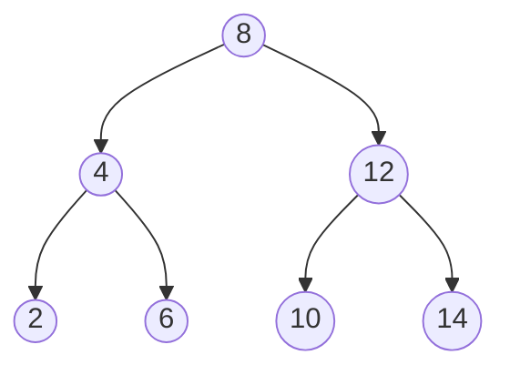


<details><summary><strong>View all 15 questions in this topic</strong></summary>

- [Q116. What is a tree data structure?](#q116)
- [Q117. What is a binary tree?](#q117)
- [Q118. What are root, leaf, parent, child and sibling?](#q118)
- [Q119. What are depth and height of a node?](#q119)
- [Q120. What is a full binary tree?](#q120)
- [Q121. What is a complete binary tree?](#q121)
- [Q122. What is a perfect binary tree?](#q122)
- [Q123. What is a balanced binary tree?](#q123)
- [Q124. What is a skewed binary tree?](#q124)
- [Q125. How many nodes can appear on level k?](#q125)
- [Q126. How do you represent a binary tree using pointers?](#q126)
- [Q127. How do you represent a complete binary tree in an array?](#q127)
- [Q128. How do you count nodes in a binary tree?](#q128)
- [Q129. How do you find the height of a binary tree?](#q129)
- [Q130. How can you check whether two binary trees are identical?](#q130)

</details>

<a id="q116"></a>
<details>
<summary><strong>Q116. What is a tree data structure?</strong></summary>

**Answer — in easy English:** A tree represents a hierarchy of nodes with a root and parent–child relationships. In a rooted tree, every node except the root has exactly one parent, and the structure contains no cycles. Trees are useful for file systems, indexes and parse structures.

**Example:** A directory contains folders, and each folder contains files.

**Complexity:** Traversal takes O(n) for n nodes.

**🎯 Interview tip:** A tree with n nodes has n-1 edges.

</details>

<a id="q117"></a>
<details>
<summary><strong>Q117. What is a binary tree?</strong></summary>

**Answer — in easy English:** A binary tree is a rooted tree in which each node has at most two ordered children, called left and right. There is no general rule requiring left values to be smaller than right values.

**Example:** Root 8 has left child 4 and right child 12.

**Complexity:** Search in an arbitrary binary tree is O(n) worst-case.

**🎯 Interview tip:** Do not confuse a binary tree with a binary search tree.

</details>

<a id="q118"></a>
<details>
<summary><strong>Q118. What are root, leaf, parent, child and sibling?</strong></summary>

**Answer — in easy English:** The root has no parent, a leaf has no children, and parent/child describe adjacent hierarchy. Siblings share the same parent. These terms let you explain traversals and mutations precisely.

**Example:** In 8 -> {4,12}, 8 is root and 4 and 12 are siblings.

**Complexity:** Terminology has no runtime cost.

**🎯 Interview tip:** One-node tree has a root that is also a leaf.

</details>

<a id="q119"></a>
<details>
<summary><strong>Q119. What are depth and height of a node?</strong></summary>

**Answer — in easy English:** Depth is the number of edges from the root to a node. Height is the number of edges on its longest downward path to a leaf. Some APIs count nodes instead of edges, so state your convention.

**Example:** Root depth 0; leaf height 0 using edge counting.

**Complexity:** Computing all heights via postorder takes O(n).

**🎯 Interview tip:** Agree on edge-count versus node-count before giving formulas.

</details>

<a id="q120"></a>
<details>
<summary><strong>Q120. What is a full binary tree?</strong></summary>

**Answer — in easy English:** A full or proper binary tree is one where every node has either zero or exactly two children. It does not require all leaves to lie on the same level. Fullness describes child counts, not overall shape.

**Example:** Root with exactly two leaf children is full.

**Complexity:** Check O(n) time.

**🎯 Interview tip:** Full and complete are different properties.

</details>

<a id="q121"></a>
<details>
<summary><strong>Q121. What is a complete binary tree?</strong></summary>

**Answer — in easy English:** A complete binary tree fills all levels except possibly the last, and the last level fills from left to right. This compact shape allows efficient array representation, which is why binary heaps use it.

**Example:** Seven nodes filling three levels form a complete binary tree.

**Complexity:** Level-order completeness check O(n).

**🎯 Interview tip:** A complete tree need not satisfy BST ordering.

</details>

<a id="q122"></a>
<details>
<summary><strong>Q122. What is a perfect binary tree?</strong></summary>

**Answer — in easy English:** A perfect binary tree has every internal node with two children and all leaves at the same depth. At height h measured in edges, it contains 2^(h+1)-1 nodes.

**Example:** Height 2 perfect tree has 7 nodes.

**Complexity:** Nodes Θ(2^h); height Θ(log n).

**🎯 Interview tip:** Perfect implies full and complete, but not the reverse.

</details>

<a id="q123"></a>
<details>
<summary><strong>Q123. What is a balanced binary tree?</strong></summary>

**Answer — in easy English:** A height-balanced tree controls its height so operations can avoid degenerating into long chains. For an AVL tree, the left/right subtree heights differ by at most one at each node. Other trees use different balance guarantees.

**Example:** AVL inserts may rotate nodes to keep height logarithmic.

**Complexity:** Balanced search operations O(log n).

**🎯 Interview tip:** Not every tree described as balanced uses the AVL condition.

</details>

<a id="q124"></a>
<details>
<summary><strong>Q124. What is a skewed binary tree?</strong></summary>

**Answer — in easy English:** A skewed tree has nodes concentrated along one chain, like a linked list. Its height becomes proportional to its node count, which makes recursive traversal deep and BST operations potentially slow.

**Example:** 1 -> right 2 -> right 3 -> right 4.

**Complexity:** Height O(n), naive BST search O(n).

**🎯 Interview tip:** Sorted insertion into an unbalanced BST can create skew.

</details>

<a id="q125"></a>
<details>
<summary><strong>Q125. How many nodes can appear on level k?</strong></summary>

**Answer — in easy English:** In a binary tree with root at level 0, each level can contain at most twice the nodes of the preceding level. Therefore the maximum number on level k is 2^k.

**Example:** At level 3, at most 8 nodes exist.

**Complexity:** Bound is O(2^k) nodes on level k.

**🎯 Interview tip:** This is an upper bound; sparse trees have fewer nodes.

</details>

<a id="q126"></a>
<details>
<summary><strong>Q126. How do you represent a binary tree using pointers?</strong></summary>

**Answer — in easy English:** Define a node class containing a value, left reference and right reference. Tree shape is encoded by links; null means a missing child. This representation handles arbitrary sparse shapes naturally.

**Example:** Node root = new Node(8); root.left = new Node(4);

**Complexity:** Allocate O(n) node space; visiting a link O(1).

**🎯 Interview tip:** Using references simplifies updates but adds object overhead.

</details>

<a id="q127"></a>
<details>
<summary><strong>Q127. How do you represent a complete binary tree in an array?</strong></summary>

**Answer — in easy English:** Store nodes level by level, left to right. For zero-based index i, the left child is at 2i+1 and the right child at 2i+2; the parent of non-root i is (i-1)/2.

**Example:** At index 2, children are indices 5 and 6.

**Complexity:** Parent/child index arithmetic O(1).

**🎯 Interview tip:** This is memory-efficient for complete trees but wasteful for sparse trees.

</details>

<a id="q128"></a>
<details>
<summary><strong>Q128. How do you count nodes in a binary tree?</strong></summary>

**Answer — in easy English:** If the tree is null, count zero. Otherwise count one for the current root plus the counts of the left and right subtrees. An iterative BFS can also count nodes without recursion.

**Example:** Three-node tree gives 1+1+1=3.

**Complexity:** O(n) time and O(h) recursion stack.

**🎯 Interview tip:** Optimisations for complete trees need correct completeness assumptions.

</details>

<a id="q129"></a>
<details>
<summary><strong>Q129. How do you find the height of a binary tree?</strong></summary>

**Answer — in easy English:** Return the maximum of left and right subtree heights plus one, with a consistent base case. If height counts nodes, null has height zero; if height counts edges, a leaf has height zero.

**Example:** Root with two leaf children has height 2 nodes or 1 edge.

**Complexity:** O(n) time, O(h) recursion stack.

**🎯 Interview tip:** State the height convention in an interview.

**Java snippet:**

```java
static int height(TreeNode n){
    if(n==null) return 0;
    return 1+Math.max(height(n.left),height(n.right));
}
```

</details>

<a id="q130"></a>
<details>
<summary><strong>Q130. How can you check whether two binary trees are identical?</strong></summary>

**Answer — in easy English:** Compare both roots, their values and recursively compare corresponding left and right subtrees. Two null nodes match; if exactly one node is null, they differ. Structure and values must both match.

**Example:** Trees 1 -> {2,3} and 1 -> {2,3} are identical.

**Complexity:** O(n) time for equal-size identical trees; O(h) stack.

**🎯 Interview tip:** Comparing only traversal outputs can miss shape differences.

</details>

[⬆ Back to topics](#-topics--question-count)

---

<a id="topic-10"></a>

## 🟡 10 · Traversals, Views & Tree Problems

> **Focus:** Preorder, inorder, postorder and BFS are tools for different tree tasks.

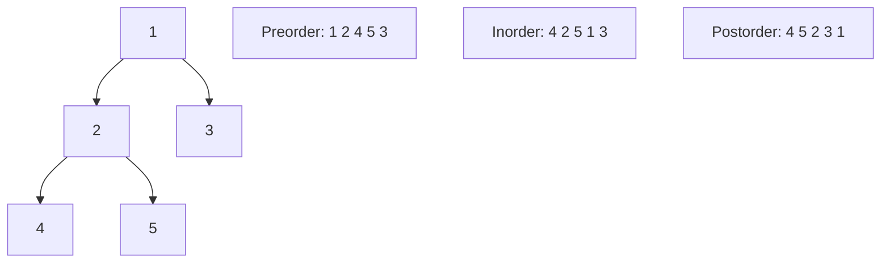


<details><summary><strong>View all 15 questions in this topic</strong></summary>

- [Q131. What is preorder traversal?](#q131)
- [Q132. What is inorder traversal?](#q132)
- [Q133. What is postorder traversal?](#q133)
- [Q134. How do you do level-order traversal?](#q134)
- [Q135. How do you perform inorder traversal iteratively?](#q135)
- [Q136. What is zigzag or spiral level-order traversal?](#q136)
- [Q137. How do you find the diameter of a binary tree?](#q137)
- [Q138. How do you check if a binary tree is height-balanced?](#q138)
- [Q139. How do you check whether a tree is symmetric?](#q139)
- [Q140. What is the lowest common ancestor (LCA)?](#q140)
- [Q141. What is vertical-order traversal?](#q141)
- [Q142. What are top view and bottom view?](#q142)
- [Q143. What are left and right views of a binary tree?](#q143)
- [Q144. What is boundary traversal?](#q144)
- [Q145. How do you serialise and deserialise a binary tree?](#q145)

</details>

<a id="q131"></a>
<details>
<summary><strong>Q131. What is preorder traversal?</strong></summary>

**Answer — in easy English:** Preorder processes the root first, then the left subtree, then the right subtree. It is useful for serialising structures, creating a copy and producing prefix expressions. An iterative form uses a stack and pushes right before left.

**Example:** For root 1 with children 2 and 3, preorder is [1,2,3].

**Complexity:** O(n) time; O(h) recursive stack for height h.

**🎯 Interview tip:** Remember Root–Left–Right.

</details>

<a id="q132"></a>
<details>
<summary><strong>Q132. What is inorder traversal?</strong></summary>

**Answer — in easy English:** Inorder visits the left subtree, processes the root, then visits the right subtree. For a valid BST with the usual ordering convention, the resulting values are sorted. For arbitrary binary trees, sorted output is not guaranteed.

**Example:** BST with values {2,1,3} visits [1,2,3].

**Complexity:** O(n) time, O(h) recursion stack.

**🎯 Interview tip:** Remember Left–Root–Right.

</details>

<a id="q133"></a>
<details>
<summary><strong>Q133. What is postorder traversal?</strong></summary>

**Answer — in easy English:** Postorder processes both children before their parent. It is useful for deleting a tree, computing subtree properties and evaluating expression trees because child results are available first.

**Example:** For root 1 with children 2 and 3, postorder is [2,3,1].

**Complexity:** O(n) time, O(h) recursion stack.

**🎯 Interview tip:** Remember Left–Right–Root.

</details>

<a id="q134"></a>
<details>
<summary><strong>Q134. How do you do level-order traversal?</strong></summary>

**Answer — in easy English:** Place the root in a queue, then repeatedly remove one node and enqueue its children. To preserve separate levels, capture queue size before processing each layer. This produces breadth-first tree traversal.

**Example:** Tree 1 -> {2,3}, 2 -> {4,5} yields levels [[1],[2,3],[4,5]].

**Complexity:** O(n) time, O(w) queue space where w is maximum width.

**🎯 Interview tip:** Check root for null before enqueuing.

**Java snippet:**

```java
static List<List<Integer>> levels(TreeNode root){
    List<List<Integer>> ans=new ArrayList<>();
    if(root==null) return ans;
    Queue<TreeNode> q=new ArrayDeque<>(); q.add(root);
    while(!q.isEmpty()){
        int size=q.size(); List<Integer> row=new ArrayList<>();
        for(int i=0;i<size;i++){
            TreeNode n=q.remove(); row.add(n.val);
            if(n.left!=null) q.add(n.left);
            if(n.right!=null) q.add(n.right);
        } ans.add(row);
    } return ans;
}
```

</details>

<a id="q135"></a>
<details>
<summary><strong>Q135. How do you perform inorder traversal iteratively?</strong></summary>

**Answer — in easy English:** Use an explicit stack: keep pushing the left chain, then pop a node, record it and move to its right child. Repeat until both current is null and stack is empty. This simulates recursive call frames.

**Example:** For 2 with children 1 and 3, output [1,2,3].

**Complexity:** O(n) time; O(h) extra stack.

**🎯 Interview tip:** Move to right only after processing the popped node.

</details>

<a id="q136"></a>
<details>
<summary><strong>Q136. What is zigzag or spiral level-order traversal?</strong></summary>

**Answer — in easy English:** Traverse level by level, reversing the output direction on alternating levels. You can collect each level normally and reverse it, or write values into the target list from either end.

**Example:** Levels [[1],[2,3],[4,5,6,7]] become [[1],[3,2],[4,5,6,7]].

**Complexity:** O(n) time, O(w) working space excluding output.

**🎯 Interview tip:** Do not accidentally change child enqueue order if using a standard BFS.

</details>

<a id="q137"></a>
<details>
<summary><strong>Q137. How do you find the diameter of a binary tree?</strong></summary>

**Answer — in easy English:** The diameter is the longest path between any two nodes, usually measured in edges. For each node, combine left and right subtree heights as a candidate, and compute heights in one postorder pass.

**Example:** A root connecting two paths of 2 and 3 edges gives a 5-edge candidate.

**Complexity:** O(n) time; O(h) recursion stack.

**🎯 Interview tip:** Define whether diameter counts nodes or edges.

</details>

<a id="q138"></a>
<details>
<summary><strong>Q138. How do you check if a binary tree is height-balanced?</strong></summary>

**Answer — in easy English:** Compute subtree heights bottom-up. If either child is already unbalanced or their heights differ by more than one, propagate a failure marker. This avoids recalculating heights separately for every node.

**Example:** A chain of four nodes is not AVL-height-balanced.

**Complexity:** O(n) time and O(h) stack.

**🎯 Interview tip:** Naive height recalculation for every node may become O(n²).

</details>

<a id="q139"></a>
<details>
<summary><strong>Q139. How do you check whether a tree is symmetric?</strong></summary>

**Answer — in easy English:** Compare the left and right subtrees in mirrored positions. Their roots must match, and the left child of one must match the right child of the other recursively. Value equality alone is insufficient without mirrored structure.

**Example:** 1 -> {2,2} with matching outward leaves is symmetric.

**Complexity:** O(n) time, O(h) stack or O(w) queue.

**🎯 Interview tip:** Mirror comparison pairs left.left with right.right.

</details>

<a id="q140"></a>
<details>
<summary><strong>Q140. What is the lowest common ancestor (LCA)?</strong></summary>

**Answer — in easy English:** The LCA of nodes p and q is their deepest shared ancestor, where a node can be its own ancestor. In a general binary tree, recursive calls return the target or target from subtrees; if each side returns a target, current is LCA.

**Example:** For leaves 4 and 5 below node 2, their LCA is 2.

**Complexity:** O(n) time and O(h) recursion stack.

**🎯 Interview tip:** State whether both target nodes are guaranteed present.

</details>

<a id="q141"></a>
<details>
<summary><strong>Q141. What is vertical-order traversal?</strong></summary>

**Answer — in easy English:** Assign column 0 to root, column-1 to left child and column+1 to right child. Group nodes by column; if ties are important, track depth and define the required ordering rule. TreeMap provides sorted columns.

**Example:** Left child at -1 and right child at +1 around root.

**Complexity:** Typically O(n log n) with ordered maps/sorting.

**🎯 Interview tip:** Different problems specify different tie-breaking orders.

</details>

<a id="q142"></a>
<details>
<summary><strong>Q142. What are top view and bottom view?</strong></summary>

**Answer — in easy English:** In vertical columns, the top view selects the shallowest visible node and bottom view selects the deepest visible node when looking along the vertical axis. BFS can keep first-seen for top and overwrite for bottom.

**Example:** A child hidden directly behind an ancestor may not appear in top view.

**Complexity:** O(n log n) with TreeMap column ordering, O(n) with hash aggregation plus sorting.

**🎯 Interview tip:** Top and bottom view depend on horizontal distance.

</details>

<a id="q143"></a>
<details>
<summary><strong>Q143. What are left and right views of a binary tree?</strong></summary>

**Answer — in easy English:** The left view contains the first node visible at each depth from the left; the right view contains the last visible from the right. A level-order traversal can pick the first or last node in each queue-sized level.

**Example:** Root 1 and next level {2,3}: left view [1,2], right view [1,3].

**Complexity:** O(n) time; O(w) queue space.

**🎯 Interview tip:** The views differ from simply following the left/right pointer chain.

</details>

<a id="q144"></a>
<details>
<summary><strong>Q144. What is boundary traversal?</strong></summary>

**Answer — in easy English:** Boundary traversal collects the outer boundary: root, left boundary excluding leaves, all leaves left to right, and right boundary excluding leaves in reverse. The exact rule requires avoiding duplicate leaves and root.

**Example:** A 3-node tree boundary is [root,leftLeaf,rightLeaf].

**Complexity:** O(n) time, O(h) traversal stack excluding output.

**🎯 Interview tip:** Do not add leaf nodes twice in boundary sections.

</details>

<a id="q145"></a>
<details>
<summary><strong>Q145. How do you serialise and deserialise a binary tree?</strong></summary>

**Answer — in easy English:** Serialisation converts tree structure into a transportable representation. Preorder or level-order output must record missing children with null markers, otherwise different shapes may look identical. Deserialisation consumes values in the same defined order.

**Example:** Preorder could encode 1,2,#,#,3,#,# with # for null.

**Complexity:** O(n) time and O(n) output/storage.

**🎯 Interview tip:** Use explicit delimiters and handle negative/multi-digit values.

</details>

[⬆ Back to topics](#-topics--question-count)

---

<a id="topic-11"></a>

## 🟡 11 · Binary Search Trees (BST)

> **Focus:** Every operation depends on tree height; consider duplicate-key policies.

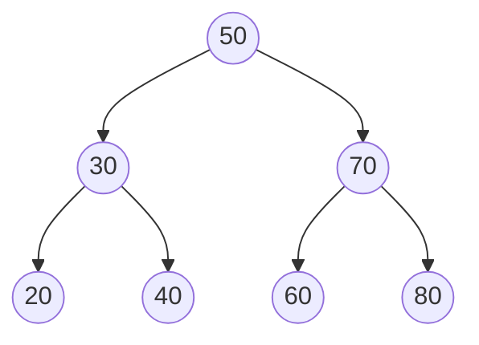


<details><summary><strong>View all 15 questions in this topic</strong></summary>

- [Q146. What is a binary search tree?](#q146)
- [Q147. How do you search in a BST?](#q147)
- [Q148. How do you insert in a BST?](#q148)
- [Q149. How do you delete a node from a BST?](#q149)
- [Q150. How do you find the minimum and maximum in a BST?](#q150)
- [Q151. What is an inorder successor in a BST?](#q151)
- [Q152. What is an inorder predecessor in a BST?](#q152)
- [Q153. How do you validate a BST correctly?](#q153)
- [Q154. How do you find kth smallest in a BST?](#q154)
- [Q155. How do you find kth largest in a BST?](#q155)
- [Q156. How do you find LCA in a BST?](#q156)
- [Q157. What is floor and ceiling in a BST?](#q157)
- [Q158. How do you convert a sorted array to a balanced BST?](#q158)
- [Q159. What is an order-statistic tree?](#q159)
- [Q160. When should you prefer TreeSet over HashSet?](#q160)

</details>

<a id="q146"></a>
<details>
<summary><strong>Q146. What is a binary search tree?</strong></summary>

**Answer — in easy English:** A BST is a binary tree where each node partitions values: all allowed values in its left subtree are smaller and right subtree are larger under a chosen comparison rule. This recursive ordering permits efficient searching when the tree height is small.

**Example:** Inserting 50, 30, 70 places 30 left and 70 right of 50.

**Complexity:** Search/insert/delete O(h); balanced h=O(log n), skewed h=O(n).

**🎯 Interview tip:** Define a consistent policy for duplicate keys.

</details>

<a id="q147"></a>
<details>
<summary><strong>Q147. How do you search in a BST?</strong></summary>

**Answer — in easy English:** Compare the target with the current node. If smaller, go left; if larger, go right; if equal, stop. BST ordering lets you discard half of the current node’s descendant directions at each step.

**Example:** Search 60 in 50 -> right 70 -> left 60.

**Complexity:** O(h) time, O(1) iterative extra space.

**🎯 Interview tip:** BST search is not always O(log n); height matters.

**Java snippet:**

```java
static boolean contains(TreeNode root,int x){
    while(root!=null){
        if(root.val==x) return true;
        root=x<root.val?root.left:root.right;
    } return false;
}
```

</details>

<a id="q148"></a>
<details>
<summary><strong>Q148. How do you insert in a BST?</strong></summary>

**Answer — in easy English:** Follow comparisons until reaching a missing left/right link, then attach the new node there. Recursion can return the updated subtree root after insertion. With duplicates, decide whether to count, reject or consistently place them.

**Example:** Insert 65 into BST with 70 -> left 60 -> right null.

**Complexity:** O(h) time and O(1) iterative space.

**🎯 Interview tip:** Without balancing, repeated sorted inserts produce a chain.

</details>

<a id="q149"></a>
<details>
<summary><strong>Q149. How do you delete a node from a BST?</strong></summary>

**Answer — in easy English:** Handle three cases: a leaf is removed directly, a one-child node is replaced by its child, and a two-child node is replaced by its inorder successor or predecessor followed by deleting that replacement node.

**Example:** Delete 50 with two children by copying successor 60 then removing original 60.

**Complexity:** O(h) time; O(h) recursion space or O(1) iterative extra space.

**🎯 Interview tip:** After replacement, prevent duplicate instances of the successor key.

</details>

<a id="q150"></a>
<details>
<summary><strong>Q150. How do you find the minimum and maximum in a BST?</strong></summary>

**Answer — in easy English:** The minimum is the leftmost node and maximum is the rightmost node because every left descendant is smaller and every right descendant larger. Start at root and follow a single direction until no child remains.

**Example:** In BST [20,30,50,70], min=20 and max=70.

**Complexity:** O(h) time and O(1) extra space.

**🎯 Interview tip:** Handle an empty BST before accessing values.

</details>

<a id="q151"></a>
<details>
<summary><strong>Q151. What is an inorder successor in a BST?</strong></summary>

**Answer — in easy English:** The successor is the next greater key in sorted order. If a node has a right subtree, use its minimum; otherwise climb ancestors until moving up from a left child, or track the last greater ancestor while searching.

**Example:** In [20,30,40,50], successor of 30 is 40.

**Complexity:** O(h) time.

**🎯 Interview tip:** A maximum key has no successor.

</details>

<a id="q152"></a>
<details>
<summary><strong>Q152. What is an inorder predecessor in a BST?</strong></summary>

**Answer — in easy English:** The predecessor is the next smaller key. If a left subtree exists, use its maximum; otherwise move towards ancestors where the current node lies in a right subtree.

**Example:** In [20,30,40,50], predecessor of 40 is 30.

**Complexity:** O(h) time.

**🎯 Interview tip:** A minimum key has no predecessor.

</details>

<a id="q153"></a>
<details>
<summary><strong>Q153. How do you validate a BST correctly?</strong></summary>

**Answer — in easy English:** Recursively ensure every node value falls within bounds inherited from all its ancestors. Checking only immediate children is insufficient because a grandchild can violate the root’s allowed range.

**Example:** A node 12 in the left subtree of root 10 makes the tree invalid even if its parent is 8.

**Complexity:** O(n) time, O(h) recursion stack.

**🎯 Interview tip:** Use long bounds for int-valued nodes and an explicit duplicate policy.

**Java snippet:**

```java
static boolean valid(TreeNode n,long low,long high){
    if(n==null) return true;
    if(n.val<=low || n.val>=high) return false;
    return valid(n.left,low,n.val) && valid(n.right,n.val,high);
}
```

</details>

<a id="q154"></a>
<details>
<summary><strong>Q154. How do you find kth smallest in a BST?</strong></summary>

**Answer — in easy English:** Inorder traversal visits BST keys in sorted order. Count visited nodes until k values have been seen. For many repeated queries, augment nodes with subtree sizes and navigate using those sizes.

**Example:** In BST [10,20,30,40], k=3 returns 30.

**Complexity:** Simple traversal O(h+k) time, O(h) stack.

**🎯 Interview tip:** Validate k is between 1 and the number of nodes.

</details>

<a id="q155"></a>
<details>
<summary><strong>Q155. How do you find kth largest in a BST?</strong></summary>

**Answer — in easy English:** Use reverse inorder traversal: right subtree, node, left subtree. Count keys until the kth visit. Augmented subtree sizes can support faster repeated queries.

**Example:** In BST [10,20,30,40], k=2 returns 30.

**Complexity:** O(h+k) time with early stopping.

**🎯 Interview tip:** Avoid collecting and sorting all values when BST order can be used.

</details>

<a id="q156"></a>
<details>
<summary><strong>Q156. How do you find LCA in a BST?</strong></summary>

**Answer — in easy English:** Use BST ordering to guide search. If both targets are less than current key, go left; if both greater, go right. Otherwise current is the split point and therefore LCA, assuming both targets exist.

**Example:** For 20 and 40 in BST rooted at 30, LCA is 30.

**Complexity:** O(h) time and O(1) iterative space.

**🎯 Interview tip:** Verify target presence if it is not guaranteed.

</details>

<a id="q157"></a>
<details>
<summary><strong>Q157. What is floor and ceiling in a BST?</strong></summary>

**Answer — in easy English:** Floor(x) is the largest key <= x, and ceiling(x) is the smallest key >= x. Walk down the BST while keeping the last candidate: going right can improve floor; going left can improve ceiling.

**Example:** With keys [10,20,40], floor(25)=20 and ceiling(25)=40.

**Complexity:** O(h) time for each query.

**🎯 Interview tip:** Use nullable results when no matching floor or ceiling exists.

</details>

<a id="q158"></a>
<details>
<summary><strong>Q158. How do you convert a sorted array to a balanced BST?</strong></summary>

**Answer — in easy English:** Choose the middle element as root and recursively build left and right subtrees from the two halves. This creates near-balanced height as long as the input is sorted and duplicates are handled consistently.

**Example:** From [1,2,3,4,5], root can be 3, with halves on either side.

**Complexity:** O(n) time and O(log n) recursion stack.

**🎯 Interview tip:** Copying subarrays unnecessarily increases allocation cost.

</details>

<a id="q159"></a>
<details>
<summary><strong>Q159. What is an order-statistic tree?</strong></summary>

**Answer — in easy English:** An order-statistic tree stores subtree sizes along with balanced BST ordering. The sizes allow selecting the kth element and finding the rank of a key without scanning the entire tree.

**Example:** If left subtree size is 5, current node has rank 6 within that subtree.

**Complexity:** Select/rank O(log n) when balanced.

**🎯 Interview tip:** Update subtree sizes during insertion, deletion and rotations.

</details>

<a id="q160"></a>
<details>
<summary><strong>Q160. When should you prefer TreeSet over HashSet?</strong></summary>

**Answer — in easy English:** Use TreeSet when sorted iteration and neighbour queries such as lower, floor, ceiling or higher matter. HashSet is usually faster for pure membership checks, but gives no sorted traversal.

**Example:** Find the nearest available timestamp using a TreeSet.

**Complexity:** TreeSet O(log n); HashSet expected O(1).

**🎯 Interview tip:** TreeSet ordering depends on comparison, not hashCode().

</details>

[⬆ Back to topics](#-topics--question-count)

---

<a id="topic-12"></a>

## 🟡 12 · Heaps & Priority Queues

> **Focus:** A heap provides a best-priority root, not sorted in-order iteration.

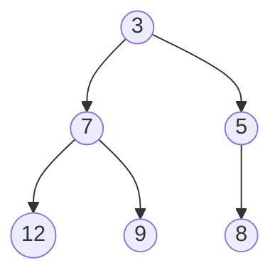


<details><summary><strong>View all 15 questions in this topic</strong></summary>

- [Q161. What is a binary heap?](#q161)
- [Q162. What is min-heap versus max-heap?](#q162)
- [Q163. How does heap insertion work?](#q163)
- [Q164. How does extract-min work?](#q164)
- [Q165. What is heapify?](#q165)
- [Q166. Why is build-heap O(n) instead of O(n log n)?](#q166)
- [Q167. How do you find the kth largest element with a heap?](#q167)
- [Q168. How do you find top K frequent elements?](#q168)
- [Q169. How do you merge K sorted lists?](#q169)
- [Q170. How do you find median from a data stream?](#q170)
- [Q171. What is heap sort?](#q171)
- [Q172. How is a heap different from a BST?](#q172)
- [Q173. What is a d-ary heap?](#q173)
- [Q174. What is a pairing heap?](#q174)
- [Q175. How do priority queues support Dijkstra’s algorithm?](#q175)

</details>

<a id="q161"></a>
<details>
<summary><strong>Q161. What is a binary heap?</strong></summary>

**Answer — in easy English:** A binary heap is a complete binary tree satisfying an order rule: in a min-heap, each parent is no larger than its children; in a max-heap, each parent is no smaller. It is usually stored compactly in an array.

**Example:** Min-heap [3,7,5,12,9,8] has minimum 3 at root.

**Complexity:** Peek O(1); insert/extract O(log n).

**🎯 Interview tip:** A heap is only partially ordered, not globally sorted.

</details>

<a id="q162"></a>
<details>
<summary><strong>Q162. What is min-heap versus max-heap?</strong></summary>

**Answer — in easy English:** In a min-heap the smallest element is available at the root, while in a max-heap the largest is at the root. The underlying array-index rules are identical; only comparisons differ.

**Example:** Java PriorityQueue is min-first; use reverseOrder() for max-first.

**Complexity:** Offer/poll O(log n), peek O(1).

**🎯 Interview tip:** Comparator mistakes can invert the intended priority.

</details>

<a id="q163"></a>
<details>
<summary><strong>Q163. How does heap insertion work?</strong></summary>

**Answer — in easy English:** Append the new value at the end, preserving completeness. Compare it with its parent and swap upward while the heap property is violated. At most one node is visited per tree level.

**Example:** Insert 2 into min-heap rooted at 3; 2 rises towards the root.

**Complexity:** O(log n) worst-case time.

**🎯 Interview tip:** Append first, then sift up.

</details>

<a id="q164"></a>
<details>
<summary><strong>Q164. How does extract-min work?</strong></summary>

**Answer — in easy English:** Remove the root result, replace it with the last element and shrink the heap. Then swap the replacement down with the smaller child until the min-heap property is restored.

**Example:** Extract 3 from [3,7,5,12] then place last element at root and sift.

**Complexity:** O(log n) time, O(1) auxiliary space within array.

**🎯 Interview tip:** Choose the smaller child when both children exist.

</details>

<a id="q165"></a>
<details>
<summary><strong>Q165. What is heapify?</strong></summary>

**Answer — in easy English:** Heapify restores heap order at one node under the assumption that its child subtrees already satisfy heap order. In bottom-up heap construction, heapify is applied to internal nodes from the last parent back to root.

**Example:** A bad root value is sifted down to a valid position.

**Complexity:** Single sift-down O(log n).

**🎯 Interview tip:** Heapify is an operation; build-heap is a sequence of such operations.

</details>

<a id="q166"></a>
<details>
<summary><strong>Q166. Why is build-heap O(n) instead of O(n log n)?</strong></summary>

**Answer — in easy English:** Most nodes sit near the leaves and need little or no sifting. Summing work by node height gives a converging weighted series bounded by O(n), not n full-height sifts.

**Example:** Start from the last internal index n/2-1 and heapify backwards.

**Complexity:** Bottom-up build-heap Θ(n).

**🎯 Interview tip:** Repeated insertions are O(n log n), which is a different algorithm.

</details>

<a id="q167"></a>
<details>
<summary><strong>Q167. How do you find the kth largest element with a heap?</strong></summary>

**Answer — in easy English:** Maintain a min-heap of at most k elements. For each number, add it and remove the minimum when size exceeds k. The root then represents the kth largest among processed values.

**Example:** For [3,2,1,5,6,4], k=2 gives 5.

**Complexity:** O(n log k) time, O(k) space.

**🎯 Interview tip:** Check that 1 <= k <= n.

**Java snippet:**

```java
static int kthLargest(int[] a,int k){
    PriorityQueue<Integer> pq=new PriorityQueue<>();
    for(int x:a){
        pq.offer(x);
        if(pq.size()>k) pq.poll();
    } return pq.peek();
}
```

</details>

<a id="q168"></a>
<details>
<summary><strong>Q168. How do you find top K frequent elements?</strong></summary>

**Answer — in easy English:** First count occurrences using a hash map, then keep a min-heap of at most k frequency–value pairs ordered by frequency. Remove lower-frequency entries as new candidates arrive; output the remaining values.

**Example:** Counts {a:5,b:2,c:3}, top 2 are a and c.

**Complexity:** O(n + u log k) expected time, O(u+k) storage for u distinct keys.

**🎯 Interview tip:** Clarify how to resolve ties in frequencies.

</details>

<a id="q169"></a>
<details>
<summary><strong>Q169. How do you merge K sorted lists?</strong></summary>

**Answer — in easy English:** Insert the first element of each non-empty list into a min-heap storing value and source list. Remove the smallest, append it to output and insert the next element from that same list. Each element enters and leaves the heap once.

**Example:** Merge [1,4], [2,5], [3,6] into [1,2,3,4,5,6].

**Complexity:** O(N log k) time, O(k) heap space for N total values.

**🎯 Interview tip:** Track each element’s source so you can advance its list.

</details>

<a id="q170"></a>
<details>
<summary><strong>Q170. How do you find median from a data stream?</strong></summary>

**Answer — in easy English:** Maintain a max-heap for the lower half and a min-heap for the upper half. Rebalance so their sizes differ by at most one and every lower-half value is <= every upper-half value. Median comes from one or two heap tops.

**Example:** For 1, 2, 3, median evolves 1, 1.5, 2.

**Complexity:** Insert O(log n), median O(1), storage O(n).

**🎯 Interview tip:** When averaging two int values, convert to long/double to avoid overflow.

</details>

<a id="q171"></a>
<details>
<summary><strong>Q171. What is heap sort?</strong></summary>

**Answer — in easy English:** Build a max-heap, then swap its maximum into the end of the active array and restore heap order on the reduced prefix. Repeat until every value is in sorted position.

**Example:** Sort [4,1,3,2] using max-heap extraction into final positions.

**Complexity:** O(n log n) time, O(1) auxiliary space for in-place implementation.

**🎯 Interview tip:** Standard heap sort is not stable.

</details>

<a id="q172"></a>
<details>
<summary><strong>Q172. How is a heap different from a BST?</strong></summary>

**Answer — in easy English:** A heap guarantees only parent–child priority order and efficient root extraction. A BST guarantees recursive left/right key ordering for searching and ordered iteration. Heap lookup for an arbitrary value may scan many nodes.

**Example:** Use a heap for jobs by priority; use BST for predecessor/successor queries.

**Complexity:** Heap arbitrary search O(n); balanced BST search O(log n).

**🎯 Interview tip:** Choosing heap versus BST depends on operations, not tree appearance.

</details>

<a id="q173"></a>
<details>
<summary><strong>Q173. What is a d-ary heap?</strong></summary>

**Answer — in easy English:** A d-ary heap gives each node up to d children instead of two. It has smaller height when d grows, but sift-down may compare more children at each level. It can be useful for workloads with many decrease-key operations.

**Example:** A 4-ary heap gives up to four children per node.

**Complexity:** Height O(log_d n); sift-down O(d log_d n).

**🎯 Interview tip:** Changing d trades fewer levels for more comparisons.

</details>

<a id="q174"></a>
<details>
<summary><strong>Q174. What is a pairing heap?</strong></summary>

**Answer — in easy English:** A pairing heap is a heap-ordered multiway tree structure with efficient melding and practically good priority-queue behaviour. It is more flexible than a binary heap for certain operations, though amortised bounds are subtle.

**Example:** Merge two priority queues by joining their roots according to priority.

**Complexity:** Find-min O(1); meld O(1); delete-min amortised O(log n) in common analysis.

**🎯 Interview tip:** Do not claim all operation bounds without specifying variant/analysis.

</details>

<a id="q175"></a>
<details>
<summary><strong>Q175. How do priority queues support Dijkstra’s algorithm?</strong></summary>

**Answer — in easy English:** Dijkstra repeatedly chooses the unsettled vertex with the smallest tentative distance. A min-priority queue makes that selection efficient. With Java PriorityQueue, duplicate entries may be pushed and stale entries ignored when popped.

**Example:** After relaxing edge A->B with cost 4, push (4,B) into the queue.

**Complexity:** With adjacency lists and binary heap: O((V+E) log V) commonly cited.

**🎯 Interview tip:** Dijkstra requires non-negative edge weights.

</details>

[⬆ Back to topics](#-topics--question-count)

---

<a id="topic-13"></a>

## 🟡 13 · Tries & Prefix Data Structures

> **Focus:** Shared prefixes make trie search and autocomplete efficient.

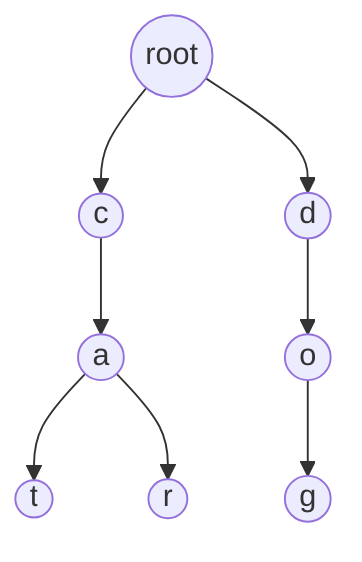


<details><summary><strong>View all 10 questions in this topic</strong></summary>

- [Q176. What is a trie?](#q176)
- [Q177. How do you insert a word into a trie?](#q177)
- [Q178. How do you search for a complete word in a trie?](#q178)
- [Q179. How do you check startsWith in a trie?](#q179)
- [Q180. How do you delete a word from a trie?](#q180)
- [Q181. What is autocomplete using a trie?](#q181)
- [Q182. How do you support wildcard word search in a trie?](#q182)
- [Q183. What is a compressed trie or radix tree?](#q183)
- [Q184. What is a binary trie for integers?](#q184)
- [Q185. Trie versus HashMap for string lookup: when to use each?](#q185)

</details>

<a id="q176"></a>
<details>
<summary><strong>Q176. What is a trie?</strong></summary>

**Answer — in easy English:** A trie stores strings by sharing prefixes in a tree of characters or symbols. Each edge represents the next symbol, and a terminal flag marks complete words. It is excellent for prefix queries and dictionaries.

**Example:** "cat" and "car" share the c -> a path.

**Complexity:** Insert/search O(L) for word length L.

**🎯 Interview tip:** Memory can be high when each node allocates many unused child pointers.

</details>

<a id="q177"></a>
<details>
<summary><strong>Q177. How do you insert a word into a trie?</strong></summary>

**Answer — in easy English:** Start at root and walk each character, creating a missing child node when necessary. After the final character, mark the current node as terminal. A prefix may be present without being a complete word.

**Example:** Insert "car" then "cat"; c and a nodes are reused.

**Complexity:** O(L) time; up to O(L) new nodes.

**🎯 Interview tip:** Set the terminal flag even if the entire path already existed.

</details>

<a id="q178"></a>
<details>
<summary><strong>Q178. How do you search for a complete word in a trie?</strong></summary>

**Answer — in easy English:** Follow character edges from root. If any required child is missing, return false. After consuming all characters, return the terminal flag, not merely whether the path exists.

**Example:** If "cart" is stored, searching complete word "car" may be false.

**Complexity:** O(L) time, O(1) iterative extra space.

**🎯 Interview tip:** A prefix path is not necessarily a stored word.

</details>

<a id="q179"></a>
<details>
<summary><strong>Q179. How do you check startsWith in a trie?</strong></summary>

**Answer — in easy English:** Follow the prefix characters just like search, but return true as soon as every prefix character has a corresponding path. You do not need the terminal flag. The empty prefix normally matches every trie.

**Example:** Stored "flower" makes startsWith("flo") true.

**Complexity:** O(P) time for prefix length P.

**🎯 Interview tip:** Specify behaviour of empty prefix for your API.

</details>

<a id="q180"></a>
<details>
<summary><strong>Q180. How do you delete a word from a trie?</strong></summary>

**Answer — in easy English:** Unmark the terminal node, then remove dead-end nodes while backtracking only when they have no children and are not terminal for another word. Shared prefix nodes must remain intact.

**Example:** Deleting "car" must not delete "cart" if it exists.

**Complexity:** O(L) time and O(L) recursive stack in common implementation.

**🎯 Interview tip:** Do not prune shared nodes.

</details>

<a id="q181"></a>
<details>
<summary><strong>Q181. What is autocomplete using a trie?</strong></summary>

**Answer — in easy English:** Navigate to the node representing the typed prefix, then traverse descendants to collect terminal words. Sorting by frequency or relevance may require storing rankings or using a heap, rather than plain alphabetical DFS.

**Example:** Typing "app" can suggest "apple" and "application".

**Complexity:** Prefix lookup O(P); output collection proportional to explored nodes/results.

**🎯 Interview tip:** Production autocomplete needs ranking and result limits.

</details>

<a id="q182"></a>
<details>
<summary><strong>Q182. How do you support wildcard word search in a trie?</strong></summary>

**Answer — in easy English:** When an exact character appears, follow its single child. For a wildcard like dot, recursively try all existing children at that position. Track remaining positions and only accept a terminal node after all symbols are consumed.

**Example:** Pattern "c.t" matches "cat" and "cut".

**Complexity:** Worst-case exponential in number of wildcards depending on alphabet/branching.

**🎯 Interview tip:** Prune failed paths early to avoid unnecessary exploration.

</details>

<a id="q183"></a>
<details>
<summary><strong>Q183. What is a compressed trie or radix tree?</strong></summary>

**Answer — in easy English:** A compressed trie merges chains of single-child nodes into longer edge labels. It reduces node overhead and can speed traversal, especially for sparse paths, while maintaining prefix-search semantics.

**Example:** Store a single edge "inter" instead of five one-child nodes.

**Complexity:** Search O(L) symbol work plus edge-management overhead.

**🎯 Interview tip:** Splitting labelled edges correctly is the tricky insertion case.

</details>

<a id="q184"></a>
<details>
<summary><strong>Q184. What is a binary trie for integers?</strong></summary>

**Answer — in easy English:** A binary trie stores integers as sequences of bits from most significant to least significant. It supports bitwise prefix operations and maximum-XOR partner queries by greedily preferring the opposite bit.

**Example:** To maximise x XOR y, at each bit choose y-bit opposite to x when possible.

**Complexity:** O(B) insert/query for fixed bit width B.

**🎯 Interview tip:** Define signed-value handling and integer bit width.

</details>

<a id="q185"></a>
<details>
<summary><strong>Q185. Trie versus HashMap for string lookup: when to use each?</strong></summary>

**Answer — in easy English:** A hash map is often simpler and memory-efficient for complete-key equality checks. A trie becomes attractive when prefix traversal, lexicographic enumeration or autocomplete are central requirements.

**Example:** Exact username lookup: map; list all words starting "auto": trie.

**Complexity:** Both full-key lookup typically O(L) character work; trie prefix O(P).

**🎯 Interview tip:** Avoid a trie if you only need occasional full-word lookup.

</details>

[⬆ Back to topics](#-topics--question-count)

---

<a id="topic-14"></a>

## 🟡 14 · Graphs & Representations

> **Focus:** Decide graph direction, edge weights and sparse/dense representation first.

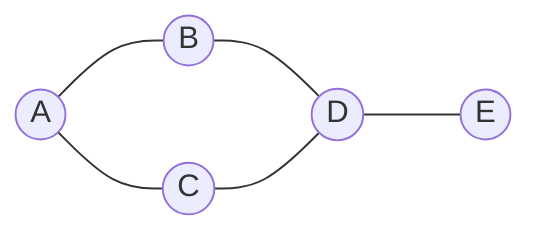


<details><summary><strong>View all 15 questions in this topic</strong></summary>

- [Q186. What is a graph?](#q186)
- [Q187. What is a directed versus undirected graph?](#q187)
- [Q188. What is a weighted graph?](#q188)
- [Q189. What is an adjacency list?](#q189)
- [Q190. What is an adjacency matrix?](#q190)
- [Q191. Adjacency list versus matrix: which should you use?](#q191)
- [Q192. What is vertex degree?](#q192)
- [Q193. What are path, walk and cycle?](#q193)
- [Q194. What is a connected component?](#q194)
- [Q195. What are strongly connected components (SCCs)?](#q195)
- [Q196. What is a DAG?](#q196)
- [Q197. What is a spanning tree?](#q197)
- [Q198. How do you represent a graph in Java?](#q198)
- [Q199. What is a bipartite graph?](#q199)
- [Q200. What is a graph bridge and articulation point?](#q200)

</details>

<a id="q186"></a>
<details>
<summary><strong>Q186. What is a graph?</strong></summary>

**Answer — in easy English:** A graph consists of vertices (entities) and edges (connections). Unlike a tree, a general graph can contain cycles, multiple routes and disconnected components. Graphs model roads, networks, dependencies and social relationships.

**Example:** Cities are vertices and roads are edges.

**Complexity:** Traversal O(V+E) with adjacency lists.

**🎯 Interview tip:** Always clarify whether edges are directed or undirected.

</details>

<a id="q187"></a>
<details>
<summary><strong>Q187. What is a directed versus undirected graph?</strong></summary>

**Answer — in easy English:** In a directed graph, an edge u→v allows travel from u to v but not automatically the reverse. In an undirected graph, an edge connects both ways. Adjacency construction must reflect this distinction.

**Example:** Twitter follow is directed; mutual physical road can be undirected.

**Complexity:** Adjacency storage O(V+E).

**🎯 Interview tip:** Do not add reverse edges to a directed graph unless specified.

</details>

<a id="q188"></a>
<details>
<summary><strong>Q188. What is a weighted graph?</strong></summary>

**Answer — in easy English:** A weighted graph attaches a number to each edge, such as distance, time or cost. Path algorithms must account for weight properties, especially whether weights can be negative.

**Example:** Road A→B takes 7 minutes, A→C takes 3 minutes.

**Complexity:** Representation is typically O(V+E) with adjacency lists.

**🎯 Interview tip:** BFS is not generally the shortest-weighted-path algorithm.

</details>

<a id="q189"></a>
<details>
<summary><strong>Q189. What is an adjacency list?</strong></summary>

**Answer — in easy English:** An adjacency list stores each vertex’s neighbours, commonly as lists or maps. It is memory-efficient for sparse graphs and allows efficient iteration over outgoing edges. Weighted variants store pairs of neighbour and weight.

**Example:** A: [B,C], B: [A,D], C: [A].

**Complexity:** Space O(V+E); scanning neighbours O(degree).

**🎯 Interview tip:** For undirected graphs, each edge usually appears twice in adjacency lists.

</details>

<a id="q190"></a>
<details>
<summary><strong>Q190. What is an adjacency matrix?</strong></summary>

**Answer — in easy English:** An adjacency matrix is a V×V table where cell [u][v] indicates whether an edge exists or stores its weight. Edge existence can be checked immediately, but memory usage grows quadratically.

**Example:** matrix[2][4] = 1 means an edge from 2 to 4.

**Complexity:** Space O(V²); edge lookup O(1).

**🎯 Interview tip:** Use a special absent marker for weighted graphs where zero is a valid weight.

</details>

<a id="q191"></a>
<details>
<summary><strong>Q191. Adjacency list versus matrix: which should you use?</strong></summary>

**Answer — in easy English:** Choose a list for sparse graphs and algorithms that scan neighbours. Choose a matrix for small or dense graphs when constant-time edge checks help. The density and operation patterns drive the choice.

**Example:** A tree-like network with V-1 edges strongly favours an adjacency list.

**Complexity:** List O(V+E) space; matrix O(V²) space.

**🎯 Interview tip:** Matrix traversal of all neighbours costs O(V) per vertex.

</details>

<a id="q192"></a>
<details>
<summary><strong>Q192. What is vertex degree?</strong></summary>

**Answer — in easy English:** In an undirected graph, degree counts incident edges, with a self-loop contributing two under the standard convention. Directed graphs distinguish indegree (incoming edges) and outdegree (outgoing edges).

**Example:** If A has arrows to B and C, outdegree(A)=2.

**Complexity:** Computable in O(V+E) from edge list.

**🎯 Interview tip:** The sum of undirected vertex degrees is 2E.

</details>

<a id="q193"></a>
<details>
<summary><strong>Q193. What are path, walk and cycle?</strong></summary>

**Answer — in easy English:** A walk follows connected edges and may repeat vertices or edges. A simple path does not repeat vertices. A cycle begins and ends at the same vertex, with distinct intermediate vertices under common definitions.

**Example:** A→B→C is a simple path; A→B→A is a cycle in an undirected multistep view.

**Complexity:** Finding paths depends on graph algorithm.

**🎯 Interview tip:** Terminology for trivial cycles/self-loops can vary by graph model.

</details>

<a id="q194"></a>
<details>
<summary><strong>Q194. What is a connected component?</strong></summary>

**Answer — in easy English:** In an undirected graph, a connected component is a maximal set of vertices where every pair is joined by some path. Repeated DFS or BFS from unvisited vertices counts components.

**Example:** Vertices {A,B,C} linked together and isolated D form two components.

**Complexity:** O(V+E) time, O(V) visited storage.

**🎯 Interview tip:** For directed graphs distinguish weak and strong connectivity.

</details>

<a id="q195"></a>
<details>
<summary><strong>Q195. What are strongly connected components (SCCs)?</strong></summary>

**Answer — in easy English:** In a directed graph, an SCC is a maximal group where every vertex can reach every other vertex. Kosaraju’s and Tarjan’s algorithms find all SCCs efficiently.

**Example:** A→B→C→A forms an SCC; D reachable only one way need not join it.

**Complexity:** O(V+E) time with Tarjan or Kosaraju.

**🎯 Interview tip:** A directed reachability set is not necessarily strongly connected.

</details>

<a id="q196"></a>
<details>
<summary><strong>Q196. What is a DAG?</strong></summary>

**Answer — in easy English:** A Directed Acyclic Graph has directed edges but no directed cycle. It models dependencies and supports topological ordering and dynamic programming in dependency order.

**Example:** Course prerequisites or build tasks form a DAG when there are no circular dependencies.

**Complexity:** DAG checks/topological sorting O(V+E).

**🎯 Interview tip:** An undirected tree is acyclic but not a DAG until directed appropriately.

</details>

<a id="q197"></a>
<details>
<summary><strong>Q197. What is a spanning tree?</strong></summary>

**Answer — in easy English:** A spanning tree of a connected undirected graph includes all vertices and exactly V-1 edges without cycles. A graph can have many different spanning trees; a minimum spanning tree additionally minimises total edge weight.

**Example:** Drop redundant edges from a connected network while retaining reachability.

**Complexity:** DFS/BFS can construct a spanning tree in O(V+E).

**🎯 Interview tip:** A spanning tree exists only for a connected graph.

</details>

<a id="q198"></a>
<details>
<summary><strong>Q198. How do you represent a graph in Java?</strong></summary>

**Answer — in easy English:** For vertices numbered 0 to V-1, use List<List<Integer>> for unweighted adjacency lists. Initialise an empty neighbour list for every vertex, then add an edge in the correct direction or both directions.

**Example:** For undirected edge (0,1), add 1 to adj[0] and 0 to adj[1].

**Complexity:** Building lists O(V+E) time and space.

**🎯 Interview tip:** Initialise every inner list or add() will fail.

**Java snippet:**

```java
List<List<Integer>> adj=new ArrayList<>();
for(int i=0;i<n;i++) adj.add(new ArrayList<>());
adj.get(0).add(1);
adj.get(1).add(0); // undirected
```

</details>

<a id="q199"></a>
<details>
<summary><strong>Q199. What is a bipartite graph?</strong></summary>

**Answer — in easy English:** A graph is bipartite if its vertices can be coloured using two colours so that every edge connects opposite colours. BFS or DFS two-colouring detects conflicts; an undirected graph is bipartite exactly when it has no odd cycle.

**Example:** A square cycle is bipartite; a triangle is not.

**Complexity:** O(V+E) time and O(V) storage.

**🎯 Interview tip:** Check every component, not only the component containing vertex 0.

</details>

<a id="q200"></a>
<details>
<summary><strong>Q200. What is a graph bridge and articulation point?</strong></summary>

**Answer — in easy English:** A bridge is an edge whose removal increases the number of connected components. An articulation point is a vertex whose removal (with incident edges) increases component count. DFS discovery times and low-link values find them efficiently.

**Example:** Removing the only edge to an isolated branch disconnects that branch.

**Complexity:** O(V+E) with Tarjan-style DFS.

**🎯 Interview tip:** Handle root of DFS tree using its special articulation rule.

</details>

[⬆ Back to topics](#-topics--question-count)

---

<a id="topic-15"></a>

## 🔴 15 · Graph Traversal & Algorithms

> **Focus:** Use BFS for fewest edges, Dijkstra for non-negative weights, Bellman–Ford for negatives.

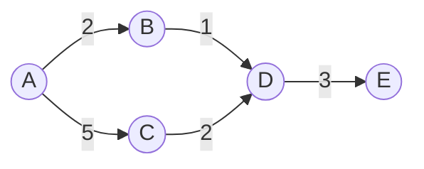


<details><summary><strong>View all 15 questions in this topic</strong></summary>

- [Q201. What is graph BFS?](#q201)
- [Q202. What is graph DFS?](#q202)
- [Q203. How do you find shortest paths in an unweighted graph?](#q203)
- [Q204. How do you detect a cycle in an undirected graph?](#q204)
- [Q205. How do you detect a cycle in a directed graph?](#q205)
- [Q206. What is topological sorting?](#q206)
- [Q207. What is Kahn’s algorithm?](#q207)
- [Q208. What is Dijkstra’s algorithm?](#q208)
- [Q209. What is Bellman–Ford?](#q209)
- [Q210. What is Floyd–Warshall?](#q210)
- [Q211. What is a minimum spanning tree (MST)?](#q211)
- [Q212. What is Kruskal’s algorithm?](#q212)
- [Q213. What is Prim’s algorithm?](#q213)
- [Q214. How do you count islands in a grid?](#q214)
- [Q215. What is flood fill?](#q215)

</details>

<a id="q201"></a>
<details>
<summary><strong>Q201. What is graph BFS?</strong></summary>

**Answer — in easy English:** Breadth-first search explores vertices in increasing unweighted distance from a start vertex. It uses a queue and a visited structure so cycles do not cause endless revisits. Parent tracking can reconstruct discovered paths.

**Example:** From A, visit all neighbours before any neighbour-of-neighbour.

**Complexity:** O(V+E) time and O(V) space with adjacency lists.

**🎯 Interview tip:** Mark visited as soon as a vertex is enqueued.

**Java snippet:**

```java
static void bfs(List<List<Integer>> g,int start){
    boolean[] seen=new boolean[g.size()];
    Queue<Integer> q=new ArrayDeque<>();
    q.add(start); seen[start]=true;
    while(!q.isEmpty()){
        int u=q.remove(); System.out.print(u+" ");
        for(int v:g.get(u)) if(!seen[v]){
            seen[v]=true; q.add(v);
        }
    }
}
```

</details>

<a id="q202"></a>
<details>
<summary><strong>Q202. What is graph DFS?</strong></summary>

**Answer — in easy English:** Depth-first search explores one path as far as possible before backtracking. It can use recursion or an explicit stack. Common uses include components, cycle detection, topological order and articulation-point analysis.

**Example:** From A→B→D, visit D before coming back to explore A→C.

**Complexity:** O(V+E) time, O(V) traversal storage.

**🎯 Interview tip:** A visited set is required for graphs with cycles.

</details>

<a id="q203"></a>
<details>
<summary><strong>Q203. How do you find shortest paths in an unweighted graph?</strong></summary>

**Answer — in easy English:** Run BFS from the source and store each neighbour’s distance as parentDistance+1 when first reached. FIFO traversal ensures this first reach uses the minimum number of edges. Parents reconstruct a path.

**Example:** In A-B-C and A-C, shortest A→C uses direct edge, length 1.

**Complexity:** O(V+E) time and O(V) distance/parent storage.

**🎯 Interview tip:** This finds fewest edges, not necessarily lowest weighted cost.

</details>

<a id="q204"></a>
<details>
<summary><strong>Q204. How do you detect a cycle in an undirected graph?</strong></summary>

**Answer — in easy English:** During DFS, keep the parent vertex. If you visit an already seen neighbour that is not the current node’s parent, a cycle exists. BFS with parent tracking also works.

**Example:** Triangle A-B-C-A contains a cycle.

**Complexity:** O(V+E) time, O(V) space.

**🎯 Interview tip:** In multigraphs with parallel edges, parent-edge ID tracking may be needed.

</details>

<a id="q205"></a>
<details>
<summary><strong>Q205. How do you detect a cycle in a directed graph?</strong></summary>

**Answer — in easy English:** Track DFS states: unvisited, currently exploring, and fully processed. An edge to a currently exploring vertex is a back edge and proves a directed cycle. Kahn’s algorithm also detects cycles when fewer than V vertices are processed.

**Example:** A→B→C→A has a back edge during DFS.

**Complexity:** O(V+E) time and O(V) space.

**🎯 Interview tip:** A visited flag alone is not enough for directed cycle detection.

</details>

<a id="q206"></a>
<details>
<summary><strong>Q206. What is topological sorting?</strong></summary>

**Answer — in easy English:** Topological sort orders vertices of a DAG so each directed edge u→v places u before v. It models dependency execution and can be computed by DFS finishing order or Kahn’s indegree queue.

**Example:** If A must finish before B, A appears before B.

**Complexity:** O(V+E) time and O(V) extra space.

**🎯 Interview tip:** Topological order is not defined for graphs with directed cycles.

</details>

<a id="q207"></a>
<details>
<summary><strong>Q207. What is Kahn’s algorithm?</strong></summary>

**Answer — in easy English:** Compute indegree for all vertices, enqueue those with indegree zero, then repeatedly remove one and decrement indegrees of its outgoing neighbours. If all vertices are output, the graph was acyclic; otherwise a cycle prevented completion.

**Example:** Course scheduling starts with courses having no prerequisites.

**Complexity:** O(V+E) time and O(V) extra space.

**🎯 Interview tip:** There may be many valid topological orders.

</details>

<a id="q208"></a>
<details>
<summary><strong>Q208. What is Dijkstra’s algorithm?</strong></summary>

**Answer — in easy English:** Dijkstra finds shortest paths from one source when all edge weights are non-negative. Maintain tentative distances, extract the smallest using a min-heap, and relax outgoing edges. Negative weights invalidate its greedy guarantee.

**Example:** Edges A→B=2, A→C=7, B→C=1 give shortest A→C distance 3.

**Complexity:** O((V+E) log V) with binary heap and adjacency lists.

**🎯 Interview tip:** Use long for accumulated distances if values may overflow int.

**Java snippet:**

```java
record Edge(int to,int w) {}
static long[] dijkstra(List<List<Edge>> g,int s){
    long INF=Long.MAX_VALUE/4;
    long[] d=new long[g.size()]; Arrays.fill(d,INF); d[s]=0;
    PriorityQueue<long[]> pq=new PriorityQueue<>(Comparator.comparingLong(x->x[0]));
    pq.add(new long[]{0,s});
    while(!pq.isEmpty()){
        long[] cur=pq.poll(); int u=(int)cur[1];
        if(cur[0]!=d[u]) continue;
        for(Edge e:g.get(u)){
            long nd=d[u]+e.w();
            if(nd<d[e.to()]){d[e.to()]=nd; pq.add(new long[]{nd,e.to()});}
        }
    } return d;
}
```

</details>

<a id="q209"></a>
<details>
<summary><strong>Q209. What is Bellman–Ford?</strong></summary>

**Answer — in easy English:** Bellman–Ford relaxes every edge up to V-1 times to find shortest paths even when negative edge weights exist. A further relaxable edge reachable from the source indicates a reachable negative cycle.

**Example:** A route with weight -2 may improve a path found earlier.

**Complexity:** O(VE) time, O(V) distance space.

**🎯 Interview tip:** Only negative cycles reachable from the source affect its computed distances.

</details>

<a id="q210"></a>
<details>
<summary><strong>Q210. What is Floyd–Warshall?</strong></summary>

**Answer — in easy English:** Floyd–Warshall computes all-pairs shortest paths using dynamic programming. At phase k, it asks whether travelling from i to j through vertex k beats the existing best distance.

**Example:** After considering B as intermediate, A→C may improve via A→B→C.

**Complexity:** O(V³) time and O(V²) space.

**🎯 Interview tip:** Guard INF additions and detect negative cycles using negative diagonal entries.

</details>

<a id="q211"></a>
<details>
<summary><strong>Q211. What is a minimum spanning tree (MST)?</strong></summary>

**Answer — in easy English:** An MST connects all vertices of a connected, weighted, undirected graph with no cycles and minimum total edge weight. It is useful for network design and differs from shortest paths from one source.

**Example:** Connect offices with minimal cable cost while keeping all connected.

**Complexity:** Kruskal O(E log E); Prim with heap O(E log V) typically.

**🎯 Interview tip:** MST algorithms should not be applied unchanged to directed graphs.

</details>

<a id="q212"></a>
<details>
<summary><strong>Q212. What is Kruskal’s algorithm?</strong></summary>

**Answer — in easy English:** Sort edges by increasing weight and add each edge if it connects two previously separate components. DSU efficiently checks whether an edge creates a cycle. Stop after choosing V-1 edges for a connected graph.

**Example:** Pick cheapest non-cycle road until every town connects.

**Complexity:** O(E log E) for sorting, near-constant amortised DSU operations.

**🎯 Interview tip:** On a disconnected graph, output is a minimum spanning forest.

</details>

<a id="q213"></a>
<details>
<summary><strong>Q213. What is Prim’s algorithm?</strong></summary>

**Answer — in easy English:** Start at any vertex and grow one tree by repeatedly selecting the cheapest edge crossing from visited to unvisited vertices. A priority queue supports efficient minimum-edge selection.

**Example:** Begin at office A, add lowest-cost link to a new office repeatedly.

**Complexity:** O(E log V) commonly with heap and adjacency lists.

**🎯 Interview tip:** Discard candidate edges that lead to already visited vertices.

</details>

<a id="q214"></a>
<details>
<summary><strong>Q214. How do you count islands in a grid?</strong></summary>

**Answer — in easy English:** Treat each land cell as a graph vertex connected to adjacent land cells under the chosen directions. Scan grid and run DFS/BFS from each unvisited land cell, marking the entire component. Each new traversal increments island count.

**Example:** A grid with two separate groups of 1s has 2 islands.

**Complexity:** O(rows·cols) time; up to O(rows·cols) visited/stack space.

**🎯 Interview tip:** Clarify whether diagonal neighbours count as connected.

</details>

<a id="q215"></a>
<details>
<summary><strong>Q215. What is flood fill?</strong></summary>

**Answer — in easy English:** Flood fill starts at a cell and recolours all connected cells having the original colour. BFS or DFS visits eligible neighbouring cells. If original and new colours are equal, return immediately to avoid useless revisits.

**Example:** Paint one connected white region blue without crossing black cells.

**Complexity:** O(rows·cols) worst-case time and space.

**🎯 Interview tip:** Check bounds and mark recoloured/visited cells exactly once.

</details>

[⬆ Back to topics](#-topics--question-count)

---

<a id="topic-16"></a>

## 🔴 16 · Disjoint Set Union (DSU)

> **Focus:** Connectivity and merges are DSU strengths; edge deletion needs other techniques.

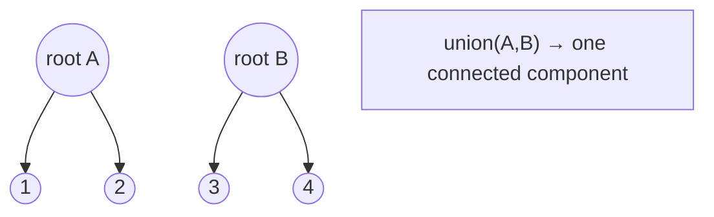


<details><summary><strong>View all 10 questions in this topic</strong></summary>

- [Q216. What is Disjoint Set Union?](#q216)
- [Q217. What is Find in DSU?](#q217)
- [Q218. What is Union in DSU?](#q218)
- [Q219. What is path compression?](#q219)
- [Q220. What is union by rank?](#q220)
- [Q221. What is union by size?](#q221)
- [Q222. How do you count connected components with DSU?](#q222)
- [Q223. How can DSU detect an undirected graph cycle?](#q223)
- [Q224. How does DSU help Kruskal’s algorithm?](#q224)
- [Q225. What is rollback DSU?](#q225)

</details>

<a id="q216"></a>
<details>
<summary><strong>Q216. What is Disjoint Set Union?</strong></summary>

**Answer — in easy English:** DSU, also called Union-Find, tracks a partition of elements into non-overlapping groups. It supports finding which group an element belongs to and merging two groups. It is useful for connectivity and Kruskal’s MST.

**Example:** Union(1,2) and union(2,3) make 1, 2, 3 one group.

**Complexity:** Optimised operations O(α(n)) amortised, nearly constant.

**🎯 Interview tip:** DSU does not directly give shortest paths.

</details>

<a id="q217"></a>
<details>
<summary><strong>Q217. What is Find in DSU?</strong></summary>

**Answer — in easy English:** Find returns a representative root identifying the set containing an element. Two elements are connected exactly when their Find results are equal. Representatives can change after unions.

**Example:** If find(4)==find(9), they are in the same component.

**Complexity:** O(α(n)) amortised when path compression and union heuristic are used.

**🎯 Interview tip:** Representative IDs have no inherent meaning beyond set identity.

</details>

<a id="q218"></a>
<details>
<summary><strong>Q218. What is Union in DSU?</strong></summary>

**Answer — in easy English:** Union combines the sets of two elements if their representatives differ. If both already share one representative, nothing changes. A union heuristic chooses which root becomes the parent to keep trees shallow.

**Example:** union(2,5) merges their components.

**Complexity:** O(α(n)) amortised with standard optimisations.

**🎯 Interview tip:** Union must use roots, not blindly link arbitrary nodes.

</details>

<a id="q219"></a>
<details>
<summary><strong>Q219. What is path compression?</strong></summary>

**Answer — in easy English:** During Find, redirect nodes on the search path to point closer to, usually directly to, their representative root. Future Find calls then traverse fewer links. It works together with union-by-size or rank for excellent amortised complexity.

**Example:** Before: 4→3→2→1; after find(4), 4,3,2 can point to 1.

**Complexity:** Part of O(α(n)) amortised DSU operations.

**🎯 Interview tip:** Path compression mutates the parent array even during Find.

</details>

<a id="q220"></a>
<details>
<summary><strong>Q220. What is union by rank?</strong></summary>

**Answer — in easy English:** Rank estimates the depth of a DSU root’s tree. Attach the lower-rank root beneath the higher-rank root; if ranks match, choose one and increment its rank. With path compression, rank is an upper bound, not necessarily the current exact height.

**Example:** Merge a rank-1 tree into rank-3 tree by attaching under rank-3 root.

**Complexity:** O(α(n)) amortised per operation with compression.

**🎯 Interview tip:** Increment rank only when equal-rank roots are merged.

</details>

<a id="q221"></a>
<details>
<summary><strong>Q221. What is union by size?</strong></summary>

**Answer — in easy English:** Track the number of elements under each representative. When merging different groups, attach the smaller group’s root under the larger group’s root and add their sizes. This prevents tall trees.

**Example:** Merging sets of sizes 3 and 8 attaches size-3 root below size-8 root.

**Complexity:** O(α(n)) amortised with path compression.

**🎯 Interview tip:** Update size only on the new root after a successful merge.

</details>

<a id="q222"></a>
<details>
<summary><strong>Q222. How do you count connected components with DSU?</strong></summary>

**Answer — in easy English:** Start with n singleton components. For each undirected edge, union its endpoints; decrement the component counter only if they were previously in different sets. The final count is the number of connected groups.

**Example:** Four nodes with edges (0,1) and (2,3) form 2 components.

**Complexity:** O((V+E)α(V)) time and O(V) space.

**🎯 Interview tip:** An edge inside the same component must not decrease the count.

</details>

<a id="q223"></a>
<details>
<summary><strong>Q223. How can DSU detect an undirected graph cycle?</strong></summary>

**Answer — in easy English:** Process undirected edges one by one. If an edge joins vertices already in the same set, that edge closes a cycle; otherwise union them. This assumes appropriate handling of self-loops and parallel edges.

**Example:** Edges (1,2), (2,3), (1,3): last edge forms a cycle.

**Complexity:** O(Eα(V)) time excluding input.

**🎯 Interview tip:** This simple check is for undirected graphs, not generic directed cycle detection.

</details>

<a id="q224"></a>
<details>
<summary><strong>Q224. How does DSU help Kruskal’s algorithm?</strong></summary>

**Answer — in easy English:** After sorting edges by weight, DSU quickly tells whether adding an edge connects separate components. Merge only such components, ensuring selected edges do not form cycles. This creates a minimum spanning forest, or an MST if connected.

**Example:** Ignore heavy edge A-C after A and C are already connected through B.

**Complexity:** Sorting O(E log E), DSU O(Eα(V)).

**🎯 Interview tip:** Always sort by edge weight before processing.

</details>

<a id="q225"></a>
<details>
<summary><strong>Q225. What is rollback DSU?</strong></summary>

**Answer — in easy English:** Rollback DSU records changes made by unions so the structure can undo them later. This is useful in offline dynamic connectivity and divide-and-conquer over time. Path compression is often avoided because it complicates efficient rollback.

**Example:** Answer whether nodes are connected at different times as edges appear and disappear.

**Complexity:** Union/find typically O(log n) with union-by-size without compression; rollback per change O(1).

**🎯 Interview tip:** Normal DSU cannot efficiently split a set after deletion.

</details>

[⬆ Back to topics](#-topics--question-count)

---

<a id="topic-17"></a>

## 🔴 17 · Segment Trees, BIT & Range Queries

> **Focus:** Understand whether queries and updates are offline, online, point or range.

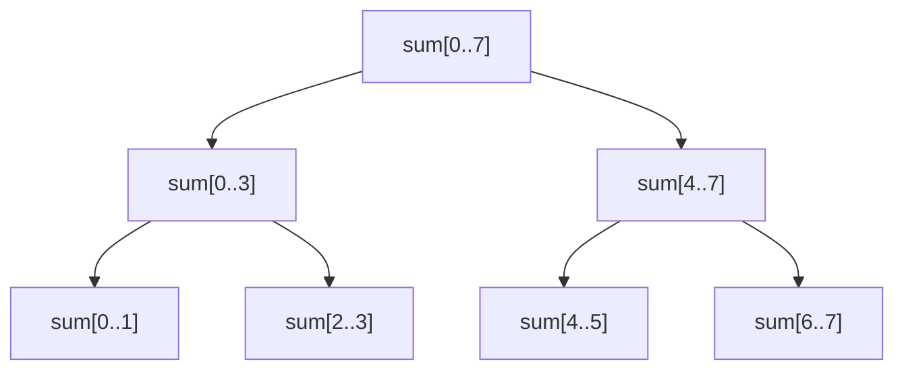


<details><summary><strong>View all 15 questions in this topic</strong></summary>

- [Q226. What is a segment tree?](#q226)
- [Q227. How do you build a segment tree?](#q227)
- [Q228. How does segment-tree range sum work?](#q228)
- [Q229. How does segment-tree point update work?](#q229)
- [Q230. What is lazy propagation?](#q230)
- [Q231. What is Range Minimum Query (RMQ)?](#q231)
- [Q232. What is a Fenwick tree (Binary Indexed Tree)?](#q232)
- [Q233. How does the lowbit operation work in BIT?](#q233)
- [Q234. Fenwick tree versus segment tree?](#q234)
- [Q235. What is a sparse table?](#q235)
- [Q236. What is Mo’s algorithm?](#q236)
- [Q237. What is a persistent segment tree?](#q237)
- [Q238. What is coordinate compression?](#q238)
- [Q239. What is an interval tree?](#q239)
- [Q240. How do you handle range add and point query efficiently?](#q240)

</details>

<a id="q226"></a>
<details>
<summary><strong>Q226. What is a segment tree?</strong></summary>

**Answer — in easy English:** A segment tree stores summaries of array intervals in a binary hierarchy. Its root covers the full array, and children divide intervals into smaller ranges. It supports fast range queries and point updates for associative operations such as sum, min or max.

**Example:** Root stores sum[0..7]; children store sums[0..3] and [4..7].

**Complexity:** Build O(n); range query O(log n); point update O(log n); space O(n).

**🎯 Interview tip:** Choose an associative merge operation with a correct identity element.

</details>

<a id="q227"></a>
<details>
<summary><strong>Q227. How do you build a segment tree?</strong></summary>

**Answer — in easy English:** For a leaf interval, store its single array element. For an internal interval, recursively build both halves and combine their summary values. Implementations often allocate up to 4n array slots to simplify indexing.

**Example:** For [1,2,3,4], parent sum = (1+2)+(3+4)=10.

**Complexity:** O(n) time and O(n) storage.

**🎯 Interview tip:** Handle n=0 separately before allocating/traversing.

</details>

<a id="q228"></a>
<details>
<summary><strong>Q228. How does segment-tree range sum work?</strong></summary>

**Answer — in easy English:** For a query interval, return zero on no overlap, the node summary on complete overlap, or recursively combine child answers on partial overlap. Because only O(log n) relevant boundary branches are explored, queries are efficient.

**Example:** Query sum[1..3] over [1,2,3,4] returns 9.

**Complexity:** O(log n) time for sum queries, O(log n) recursion stack.

**🎯 Interview tip:** Correct overlap checks are more important than memorising code.

</details>

<a id="q229"></a>
<details>
<summary><strong>Q229. How does segment-tree point update work?</strong></summary>

**Answer — in easy English:** Follow the unique root-to-leaf path covering the updated index. Change that leaf, then recompute summaries of all ancestors on the way back. Unaffected subtrees do not need any work.

**Example:** Change a[2] from 3 to 8; ancestors gain +5 in a sum tree.

**Complexity:** O(log n) time.

**🎯 Interview tip:** Update original array as well if you retain it for other operations.

</details>

<a id="q230"></a>
<details>
<summary><strong>Q230. What is lazy propagation?</strong></summary>

**Answer — in easy English:** Lazy propagation delays applying a range update to all descendants. Each segment node stores a pending update that is pushed to children only when necessary. This supports efficient range updates and range queries.

**Example:** Add 5 to interval [2..6] without modifying every leaf immediately.

**Complexity:** Range add/range sum O(log n) per operation with appropriate lazy values.

**🎯 Interview tip:** Applying an add tag to a sum segment changes sum by add×segmentLength.

</details>

<a id="q231"></a>
<details>
<summary><strong>Q231. What is Range Minimum Query (RMQ)?</strong></summary>

**Answer — in easy English:** RMQ asks for the minimum element within an index interval. Static arrays can use sparse tables for constant-time queries after preprocessing; dynamic arrays can use segment trees for logarithmic updates and queries.

**Example:** RMQ on [7,3,9,2] for indices 1..3 gives 2.

**Complexity:** Segment tree build O(n), query/update O(log n).

**🎯 Interview tip:** Minimum is associative and idempotent, making sparse tables practical.

</details>

<a id="q232"></a>
<details>
<summary><strong>Q232. What is a Fenwick tree (Binary Indexed Tree)?</strong></summary>

**Answer — in easy English:** A Fenwick tree stores partial sums according to the lowest set bit of each 1-based index. Prefix sum and point-update operations climb or descend index relationships using bit arithmetic. It uses less code and memory than a general segment tree for sum-like tasks.

**Example:** Store array [1,2,3] and query prefix sum through index 3 = 6.

**Complexity:** Build O(n) possible; update/query O(log n); space O(n).

**🎯 Interview tip:** BIT indexing is usually 1-based, unlike Java arrays.

</details>

<a id="q233"></a>
<details>
<summary><strong>Q233. How does the lowbit operation work in BIT?</strong></summary>

**Answer — in easy English:** lowbit(i) = i & -i isolates the least significant set bit. For updating a Fenwick tree, add lowbit(i) to reach larger responsible ranges; for prefix sums, subtract lowbit(i) to move towards zero.

**Example:** lowbit(12 binary 1100) is 4.

**Complexity:** Bit operation O(1).

**🎯 Interview tip:** Index 0 has lowbit 0, so an update loop starting at zero never progresses.

</details>

<a id="q234"></a>
<details>
<summary><strong>Q234. Fenwick tree versus segment tree?</strong></summary>

**Answer — in easy English:** Fenwick trees are compact and simple for prefix queries and invertible aggregation such as sums, while segment trees handle a wider family of range monoids, lazy updates and complex aggregate states. Choose based on supported operations.

**Example:** Use BIT for frequent point increments and prefix sums; segment tree for range minimum with updates.

**Complexity:** Both commonly O(log n) operations; segment tree uses larger constants/memory.

**🎯 Interview tip:** A basic BIT does not directly answer arbitrary range minimum with point changes.

</details>

<a id="q235"></a>
<details>
<summary><strong>Q235. What is a sparse table?</strong></summary>

**Answer — in easy English:** A sparse table precomputes answers for ranges of lengths 1,2,4,8,... and uses overlapping blocks for idempotent operations such as minimum or maximum. It is highly effective for many queries on an immutable array.

**Example:** RMQ on [5,1,6,2] combines two precomputed intervals of size 2.

**Complexity:** Preprocess O(n log n), RMQ O(1), storage O(n log n).

**🎯 Interview tip:** O(1) overlapping-block trick does not work directly for ordinary sum.

</details>

<a id="q236"></a>
<details>
<summary><strong>Q236. What is Mo’s algorithm?</strong></summary>

**Answer — in easy English:** Mo’s algorithm reorders many offline range queries so consecutive query intervals differ by relatively few endpoint moves. Maintain a mutable answer while adding/removing elements at the boundaries.

**Example:** Answer thousands of distinct-count subarray queries after sorting them by blocks.

**Complexity:** Typical O((n+q)√n) movement bound for suitable problems.

**🎯 Interview tip:** Queries must be known offline and support efficient add/remove.

</details>

<a id="q237"></a>
<details>
<summary><strong>Q237. What is a persistent segment tree?</strong></summary>

**Answer — in easy English:** A persistent segment tree keeps historical versions after updates by copying only nodes on the changed root-to-leaf path and sharing untouched subtrees. It enables time-travel queries over different versions.

**Example:** Query array sum before and after the fifth update without rebuilding.

**Complexity:** Update O(log n) new nodes; query O(log n) per version.

**🎯 Interview tip:** Version roots must be stored and old nodes treated as immutable.

</details>

<a id="q238"></a>
<details>
<summary><strong>Q238. What is coordinate compression?</strong></summary>

**Answer — in easy English:** Coordinate compression maps large or sparse numeric keys to dense ranks while preserving their relative order. This lets indexed structures like BIT and segment trees work on ranges defined by up to millions or billions of possible values.

**Example:** Values [100,10000,500] map to ranks [0,2,1].

**Complexity:** Sort unique values O(n log n); each mapping O(log n) or average O(1) with map.

**🎯 Interview tip:** Compression preserves ordering but not original numeric distances.

</details>

<a id="q239"></a>
<details>
<summary><strong>Q239. What is an interval tree?</strong></summary>

**Answer — in easy English:** An interval tree stores ranges and supports queries for intervals overlapping a target point or interval. Nodes may maintain the maximum endpoint in each subtree to prune branches during searches.

**Example:** Find calendar bookings intersecting 2pm–3pm.

**Complexity:** Balanced versions offer O(log n + k) reporting for k overlaps in suitable variants.

**🎯 Interview tip:** Interval overlap queries differ from range-sum queries.

</details>

<a id="q240"></a>
<details>
<summary><strong>Q240. How do you handle range add and point query efficiently?</strong></summary>

**Answer — in easy English:** Use a difference array if updates can be applied in a batch, or use a Fenwick tree over differences for online operations. Add value x at left boundary and -x immediately after right boundary; prefix sum at a point gives its accumulated additions.

**Example:** Add +3 to [2..5], then query index 4 to see +3.

**Complexity:** BIT supports O(log n) range add and point query.

**🎯 Interview tip:** Mind inclusive endpoints and 1-based BIT indices.

</details>

[⬆ Back to topics](#-topics--question-count)

---

<a id="topic-18"></a>

## 🔴 18 · Balanced Trees & Advanced Structures

> **Focus:** Understand invariants and I/O-oriented indexing, not just definitions.

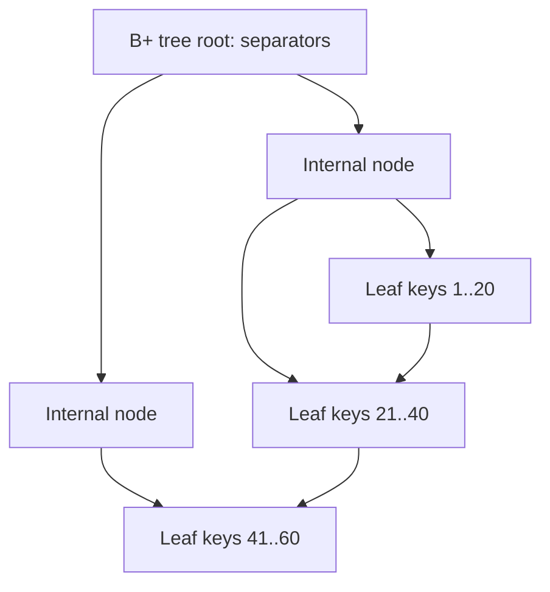


<details><summary><strong>View all 10 questions in this topic</strong></summary>

- [Q241. What is an AVL tree?](#q241)
- [Q242. What is a tree rotation?](#q242)
- [Q243. What is a Red–Black tree?](#q243)
- [Q244. AVL versus Red–Black tree: what is the trade-off?](#q244)
- [Q245. What is a B-tree?](#q245)
- [Q246. What is a B+ tree?](#q246)
- [Q247. B-tree versus B+ tree?](#q247)
- [Q248. What is a skip list?](#q248)
- [Q249. What is a suffix array?](#q249)
- [Q250. How do you choose between advanced data structures in interviews?](#q250)

</details>

<a id="q241"></a>
<details>
<summary><strong>Q241. What is an AVL tree?</strong></summary>

**Answer — in easy English:** An AVL tree is a self-balancing BST where each node’s left and right subtree heights differ by at most one. Insertion and deletion may trigger rotations, keeping its height logarithmic for fast ordered operations.

**Example:** Insert 10,20,30; a left rotation can make 20 the balanced root.

**Complexity:** Search/insert/delete O(log n).

**🎯 Interview tip:** Maintain heights correctly after rotations.

</details>

<a id="q242"></a>
<details>
<summary><strong>Q242. What is a tree rotation?</strong></summary>

**Answer — in easy English:** A rotation changes a small number of parent/child links while preserving inorder key order. Left and right rotations rebalance BSTs without rearranging keys arbitrarily. Double rotations fix certain inner-heavy cases.

**Example:** 10 -> right 20 -> right 30 becomes 20 with children 10 and 30.

**Complexity:** Single rotation O(1) pointer changes.

**🎯 Interview tip:** Update subtree metadata such as heights and sizes after each rotation.

</details>

<a id="q243"></a>
<details>
<summary><strong>Q243. What is a Red–Black tree?</strong></summary>

**Answer — in easy English:** A Red–Black tree is a self-balancing BST that assigns colours to nodes and enforces rules limiting the length of paths. Recolouring and rotations maintain logarithmic tree height with relatively small update overhead.

**Example:** Java TreeMap and TreeSet are implemented using a Red–Black tree.

**Complexity:** Search/insert/delete O(log n).

**🎯 Interview tip:** Remember: no red node may have a red child in the standard rules.

</details>

<a id="q244"></a>
<details>
<summary><strong>Q244. AVL versus Red–Black tree: what is the trade-off?</strong></summary>

**Answer — in easy English:** AVL trees enforce tighter height balance and may support slightly faster lookups. Red–Black trees permit looser balance and often need fewer rotations for updates. Both guarantee logarithmic search and updates.

**Example:** Read-heavy ordered index can favour AVL; mixed operations often use Red–Black.

**Complexity:** Both O(log n) search/insert/delete.

**🎯 Interview tip:** Asymptotic bounds alone do not predict actual benchmark winners.

</details>

<a id="q245"></a>
<details>
<summary><strong>Q245. What is a B-tree?</strong></summary>

**Answer — in easy English:** A B-tree is a balanced multiway search tree that stores multiple keys per node and has many children. Its broad nodes reduce the number of disk/page accesses, making it suitable for external storage indexes.

**Example:** One node might separate child key ranges using keys [20,50,90].

**Complexity:** Search/insert/delete O(log_B n) node/page visits in a suitable B-tree.

**🎯 Interview tip:** A B-tree is not a binary tree; node capacity depends on order.

</details>

<a id="q246"></a>
<details>
<summary><strong>Q246. What is a B+ tree?</strong></summary>

**Answer — in easy English:** A B+ tree stores search separators in internal nodes while actual records or record pointers live at leaves. Leaves are commonly linked to support efficient ordered range scans. Database systems frequently use B+ tree-style indexes.

**Example:** Find first key >= 100, then follow leaf links until key > 200.

**Complexity:** Point lookup O(log_B n) pages; range scan O(log_B n + output pages).

**🎯 Interview tip:** Exact node storage varies by database implementation.

</details>

<a id="q247"></a>
<details>
<summary><strong>Q247. B-tree versus B+ tree?</strong></summary>

**Answer — in easy English:** Both are balanced external-memory search trees. A classic B-tree can keep records in internal nodes as well as leaves; a B+ tree concentrates records at leaves and typically links leaves for sequential access. B+ trees are especially convenient for range scans.

**Example:** SQL index range scans commonly exploit adjacent leaf pages.

**Complexity:** Both have logarithmic tree height.

**🎯 Interview tip:** Use database-specific terminology where implementations differ.

</details>

<a id="q248"></a>
<details>
<summary><strong>Q248. What is a skip list?</strong></summary>

**Answer — in easy English:** A skip list is a probabilistic layered linked structure. Higher layers contain progressively fewer elements, allowing searches to skip over large parts of the base sorted list. It supports ordered operations without tree rotations.

**Example:** Express lanes in a linked list let search jump near the target.

**Complexity:** Expected search/insert/delete O(log n), worst-case O(n).

**🎯 Interview tip:** Random level generation affects memory and balancing.

</details>

<a id="q249"></a>
<details>
<summary><strong>Q249. What is a suffix array?</strong></summary>

**Answer — in easy English:** A suffix array lists starting indices of a string’s suffixes in lexicographic order. It supports efficient substring queries and is often paired with an LCP array storing longest common prefixes of adjacent sorted suffixes.

**Example:** For "banana", sorted suffixes include "a", "ana", "anana", "banana", ...

**Complexity:** Search O(m log n) by naive suffix comparisons; construction depends on algorithm.

**🎯 Interview tip:** Suffix arrays and suffix trees solve related but not identical tasks.

</details>

<a id="q250"></a>
<details>
<summary><strong>Q250. How do you choose between advanced data structures in interviews?</strong></summary>

**Answer — in easy English:** Start with the exact operations and constraints: prefix lookup suggests trie, ordered neighbours suggest balanced BST, repeated min extraction suggests heap, range aggregates suggest BIT/segment tree, historical versions suggest persistence, and disk-friendly indexes suggest B+ tree. Then justify complexity and memory.

**Example:** Dynamic range sums: BIT; dynamic range minimum: segment tree; ordered index: TreeMap.

**Complexity:** Choose by query/update mix, not by which structure sounds advanced.

**🎯 Interview tip:** Clearly state assumptions about input size, online/offline queries and duplicates.

</details>

[⬆ Back to topics](#-topics--question-count)

---

## ⚡ Complexity cheat sheet

**Common assumptions:** `n` is number of elements, `h` is tree height, `V` vertices, `E` edges, `L` word length, and `k` a heap/window parameter. Bounds assume ordinary implementations and explicitly stated invariants.

| Structure | Access / Search | Insert | Delete / Extract | Important note |
|---|---|---|---|---|
| Array | Index **O(1)**; find **O(n)** | Middle **O(n)** | Middle **O(n)** | Fixed length |
| ArrayList | Index **O(1)**; find **O(n)** | End **O(1) amortised** | Middle **O(n)** | Occasional resize |
| Singly linked list | Find **O(n)** | Head **O(1)** | Known predecessor **O(1)** | Traversal needed to locate node |
| Stack / deque | Top/end **O(1)** | End **O(1)** | End **O(1)** | Depends on implementation |
| HashMap / HashSet | **O(1)** expected | **O(1)** expected | **O(1)** expected | Hash distribution affects worst case |
| Balanced BST | **O(log n)** | **O(log n)** | **O(log n)** | Ordered keys |
| Unbalanced BST | **O(h)** | **O(h)** | **O(h)** | Height can be `n` |
| Binary heap | Root **O(1)**; arbitrary find **O(n)** | **O(log n)** | Root **O(log n)** | Bottom-up build **O(n)** |
| Trie | **O(L)** | **O(L)** | **O(L)** | Prefix-friendly |
| Disjoint Set Union | `find` **O(α(n)) amortised** | `union` **O(α(n)) amortised** | Not supported generally | With path compression + size/rank |
| Fenwick tree | Prefix sum **O(log n)** | Point update **O(log n)** | Point update **O(log n)** | Sum-style operations |
| Segment tree | Range query **O(log n)** | Point update **O(log n)** | Point update **O(log n)** | Flexible range aggregates |

### Graph algorithm fast selection

| Need | Recommended technique | Typical complexity |
|---|---|---|
| Visit every vertex | BFS / DFS | `O(V+E)` |
| Fewest edges in unweighted graph | BFS | `O(V+E)` |
| Shortest path with non-negative weights | Dijkstra + min heap | `O((V+E) log V)` |
| Shortest path with negative weights | Bellman–Ford | `O(VE)` |
| All-pairs shortest paths on modest V | Floyd–Warshall | `O(V³)` |
| Topological order in DAG | Kahn / DFS | `O(V+E)` |
| Minimum spanning tree | Kruskal / Prim | `O(E log E)` / often `O(E log V)` |
| Incremental connectivity | DSU | `O(α(V))` amortised per operation |

## 🧪 Run the Java examples

A standalone **Java 17+** practice file is included with executable examples for linked lists, sliding windows, hashing, heap, trees, graphs, DSU, Fenwick tree, segment tree and trie.

```bash
# From this repository root:
javac examples/DataStructurePlayground.java
java -cp examples DataStructurePlayground
```

The program runs built-in assertions and prints **`All data-structure demos passed.`** when successful. To see the source, open [DataStructurePlayground.java](examples/DataStructurePlayground.java). These tests exercise representative cases; they are not a complete proof of correctness for all inputs.

## 🗓️ Study plan

| Days | Focus | What to practise |
|---|---|---|
| 1–3 | Foundations, arrays, strings | Complexity, two pointers, prefix sum, sliding window |
| 4–6 | Linked lists, stacks, queues | Reverse list, cycle detection, balanced brackets, monotonic deque |
| 7–9 | Hashing, recursion | Two Sum, anagrams, memoisation, backtracking |
| 10–13 | Trees, traversals, BST | Tree height, LCA, views, validate BST, deletion |
| 14–16 | Heaps, tries | Top K, merge K lists, streaming median, prefix search |
| 17–19 | Graphs, DSU | BFS/DFS, Dijkstra, Kruskal, bipartite check |
| 20–21 | Advanced structures + mock interview | Segment tree, Fenwick tree, AVL/Red–Black/B+ trees |

**Interview practice habit:** For any coding problem, state the input/output, ask about edge cases, describe the brute-force approach, choose a suitable structure, write Java code, test by hand and analyse time/space. Repeat missed questions after a few days.

## 🚩 Common interview mistakes

1. Saying a hash map guarantees O(1) worst-case for every implementation.
2. Assuming every BST is balanced or that a binary heap is fully sorted.
3. Confusing a substring (contiguous) with a subsequence (possibly skipping positions).
4. Forgetting null/empty, duplicate-key, integer overflow or index-boundary cases.
5. Using BFS for shortest weighted paths or Dijkstra with negative edges.
6. Omitting visited tracking in graphs, which can create infinite traversals.
7. Mixing up amortised runtime with average-case runtime.
8. Forgetting that Java recursion uses real call-stack space.
9. Failing to maintain both links when changing a doubly linked list.
10. Presenting only code without the invariant or explanation of *why it works*.

## 🔖 Trusted learning references

- [Oracle Java Collections Framework](https://docs.oracle.com/en/java/javase/17/docs/api/java.base/java/util/package-summary.html)
- [Oracle Java Deque](https://docs.oracle.com/en/java/javase/17/docs/api/java.base/java/util/Deque.html)
- [Oracle Java PriorityQueue](https://docs.oracle.com/en/java/javase/17/docs/api/java.base/java/util/PriorityQueue.html)
- [Oracle Java HashMap](https://docs.oracle.com/en/java/javase/17/docs/api/java.base/java/util/HashMap.html)
- [OpenJDK](https://openjdk.org/)

## 🤝 Contributing

Found an error or have a better Java explanation? Please open an issue or submit a pull request. The [contribution guide](CONTRIBUTING.md) explains the expected format and testing checklist. Contributions should be original, accurate and respectful of source licences.

If this handbook helped you prepare, consider **⭐ starring the repository**, sharing it with other learners, or suggesting additional interview scenarios.

---

<div align="center">

**Made for learners by [Code with Jamshed](https://github.com/Jamshed7664)**  
*Learn the idea → Draw the structure → Implement in Java → Explain the trade-off.*

</div>
